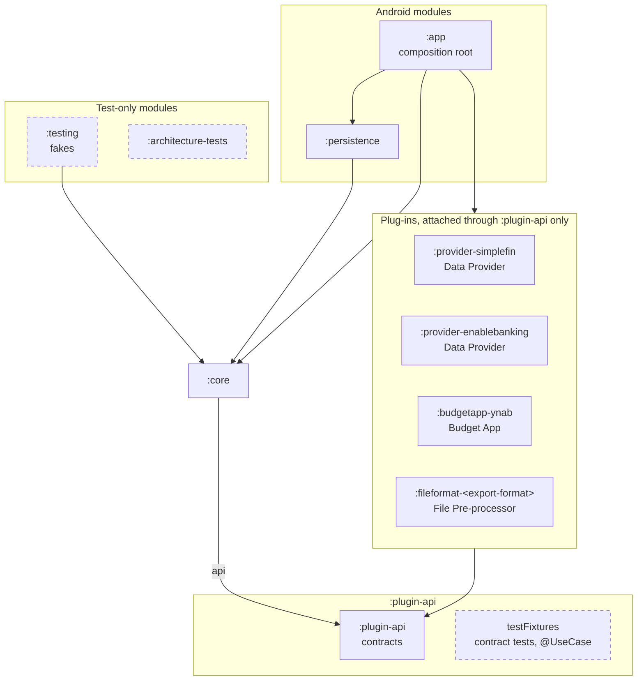

# ADR-001: Module Boundaries, Plug-in Contracts and Their Enforcement

## Status

Accepted (2026-10-15, by the Operator at the architecture gate); revised for S-23/S-24/S-25/S-26 and re-checked externally (2026-10-18, `docs/reviews/mockup_gate_recheck.md`, no High finding).

History: proposed 2026-10-14, construction kickoff Phase 1; revised 2026-10-14 at the architecture gate after the
Phase 2 review and the specification changes S-01 to S-10; revised 2026-10-15 after the Phase 2b re-review and S-12 to
S-14; revised for S-23/S-24 on 2026-10-16 and for S-25 and S-26 on 2026-10-18, pending an external check; later revisions at
the gate are listed under "Review findings addressed".

## Context

The Approved specification asks for a structure in which the rules that fetch, compare, review and decide never
depend on one Data Provider, one File Format or one Budget App:

- vision, Constraints: *Extensible Data Providers and File Formats*, *Replaceable Budget App*, *Private build for
  one Operator* ("the design keeps its concerns separated");
- NFR-014: adding a Data Provider or a File Pre-processor changes 0 files of the rules that compare, review and
  decide; NFR-015 (changed by S-05): every rule that depends on one Budget App's behaviour lives in that Budget App's
  own part, which also declares whether the Budget App supports the Cleared marker and whether it refuses a
  transaction whose Import Identifier it already holds in the Budget Account;
- FR-072, FR-073, FR-083, FR-084, FR-085; C-008, C-009, C-010; UC-012 BR-005, BR-006, A2, A3, A4;
- UC-002 BR-007: each File Format has one File Pre-processor that converts the Bank's file into the Standard Import
  Format;
- the specification changes of the architecture gate (construction kickoff plan §6): S-01 the file upload window is
  one Operator Setting for every File Format (FR-094); S-02 `BANK_SESSION`; S-03 and S-10 the Configuration Key and
  `BANK_ACCOUNT.configured` (FR-096, both superseded by S-23); S-05 the Budget App capability "refuses a reused Import Identifier"; S-06 the
  Recovery Check (FR-095, `RECOVERY_CHECK`); S-07 the Unreadable Transaction (`UNREADABLE_TRANSACTION`); S-08 the
  Offered Bank Account (`OFFERED_BANK_ACCOUNT`); S-09 `BUDGET_APP_TRANSACTION.memo`; NFR-019 and C-015 the backup size
  warning; S-11 NFR-020 identifier uniqueness; S-12 the stored copy keeps Transfer link, merge target, Cleared and
  approved (`BUDGET_APP_TRANSACTION`, UC-003 BR-020); S-14 marker ownership and `entered_by` Slussen Unsupported Format
  (UC-003 BR-001, BR-008); S-23 Budgets, Bank Accounts and Account Mappings set in the app (UC-013, UC-009, FR-097 to
  FR-100), a generated Bank Account identifier, deliberate moves of an Account Mapping (UC-009 BR-003, UC-003 BR-021);
  S-24 service credentials entered in the app and kept only on the device (UC-014, FR-101, FR-102, NFR-021), the
  Request Limit declared by each Data Provider's part (FR-017), no credential in a built app (UC-012 BR-012).

The Operator decided (bootstrap plan O-03): Gradle modules for the core, each Budget App, each Data Provider, each
File Pre-processor and the app, enforced by Konsist architecture tests, recorded in an ADR before construction. The
Operator's answer to O-P1-01: the File Pre-processor module is named after its export format, not after the Bank.

Evidence from the Predecessor App (`ynab-import-android` at `46efbf0`, read through
`scratch/construction_inventory.md`), used as evidence and not as a template:

- Eight modules: `:domain`, `:source-simplefin`, `:source-enablebanking`, one `:source-*` module for a Bank's export
  file, `:budget-ynab`, `:test-support`, and, only when an Android SDK is installed, `:platform` and `:app`.
- The plug-in modules depended on the whole `:domain`, so a Data Provider could call any rule of the core.
- Boundaries were enforced by a custom `verifyArchitecture` task that scanned `import` lines of a hard-coded module
  list. It could not see a fully qualified reference, did not check the Gradle dependency graph, and its UI rule
  "passes vacuously when app is empty".
- `:platform` and `:app` were dropped silently when no Android SDK was present, so a build could pass without
  compiling or checking the Android code.

The Phase 2 review (`docs/reviews/phase2_architecture_review.md`) found that the contracts left request admission,
per-scope outcomes, consent correlation, the Budget App's capabilities and the read model under-specified, and that
the static checks were claimed to prove more than they can (A-09 to A-15, A-18 to A-21, A-23).

## Decision

### Module map

Allowed project dependencies of §2: a solid arrow points from the depending module to its dependency in production
configurations; dashed boxes are test-only; the dependencies allowed in tests only are in the §2 table and are not
drawn; an arrow from or to a group stands for every module in it.



The text of this ADR is authoritative; the diagram only illustrates it.

### 1. Modules

Package root is `slussen`. Every module owns exactly one package root and nothing else.

| Module | Gradle plugin | Package root | Responsibility |
|---|---|---|---|
| `:plugin-api` | `kotlin("jvm")` | `slussen.pluginapi` | The three plug-in contracts (§4), their value types, the request context (§4.0), the diagnostic logging contract (ADR-006) and the Standard Import Format. Nothing else. Ships, as `testFixtures`, the contract tests (§4.4) and the `@UseCase` test annotation (ADR-004). |
| `:core` | `kotlin("jvm")` | `slussen.core` | Every rule that fetches, imports, compares, reviews, decides, plans, uploads and reports, in Slussen's own terms (glossary). The domain model of `docs/entity_model.md` as Kotlin types. The operation coordinator (ADR-007), the Import Identifier protocol (ADR-008). The ports (§3) that persistence and the app implement. |
| `:provider-simplefin` | `kotlin("jvm")` | `slussen.provider.simplefin` | The SimpleFIN Data Provider. |
| `:provider-enablebanking` | `kotlin("jvm")` | `slussen.provider.enablebanking` | The Enable Banking Data Provider, including its Bank Consent capability. |
| `:budgetapp-ynab` | `kotlin("jvm")` | `slussen.budgetapp.ynab` | The YNAB Budget App: everything that depends on YNAB's behaviour (C-009). |
| `:fileformat-<export-format>` | `kotlin("jvm")` | `slussen.fileformat.<export-format without hyphens>` | The one File Pre-processor of this build (C-010), named after the export format it reads, never after a Bank (O-P1-01): for example `:fileformat-hsa-csv` with package root `slussen.fileformat.hsacsv`. The class inside may name the Bank. |
| `:persistence` | `com.android.library` | `slussen.persistence` | Room databases, DAOs and the implementations of the core's storage ports; the start sequence, last good copy and backup rule files (ADR-002). |
| `:app` | `com.android.application` | `slussen.app` | Compose UI and ViewModels, the composition root, the Scheduled Fetch worker, the New Transaction Notification, the return from Strong Customer Authentication, file choosing and saving (also the private key file of a service credential), the screens of UC-013 and UC-014, and the log adapter (ADR-006). No configuration is generated into it (ADR-003 §3). |
| `:testing` | `kotlin("jvm")` | `slussen.testing` | Test-only: in-memory fakes of the core's ports and of the three plug-in contracts, invented example data. |
| `:architecture-tests` | `kotlin("jvm")` | `slussen.architecture` | Test-only: the Konsist rules (§6.2), the bytecode rules (§6.3) and the traceability checks of ADR-004. |

Naming rule for later modules: a Data Provider is `:provider-<name>`, a Budget App is `:budgetapp-<name>`, a File
Pre-processor is `:fileformat-<name>`; `<name>` is words of lowercase letters and digits joined by single hyphens, and
the package root is `<name>` with the hyphens removed.

Build logic lives in an included build `build-logic/` (convention plugins, the module-graph check of §6.1, the task
graph of §6.4, the release signing and no-credential checks of ADR-003, the version name and signing of ADR-005). It is not an app
module.

Every module is always part of the build. There is no module that is included only when an Android SDK is present
(ADR-005).

### 2. Allowed dependencies

Only the project dependencies in this table are allowed. Every other project dependency fails the build.

| Module | May depend on (`implementation` / `api`) | May depend on in tests only |
|---|---|---|
| `:plugin-api` | none | none |
| `:core` | `:plugin-api` (as `api`) | `:testing`, `testFixtures(:plugin-api)` |
| `:provider-*`, `:budgetapp-*`, `:fileformat-*` | `:plugin-api` | `testFixtures(:plugin-api)` |
| `:persistence` | `:core` | `:testing`, `testFixtures(:plugin-api)` |
| `:app` | `:core`, `:persistence`, every `:provider-*`, `:budgetapp-*` and `:fileformat-*` | `:testing`, `testFixtures(:plugin-api)` |
| `:testing` | `:core` | none |
| `:architecture-tests` | none (Konsist reads the source files; the bytecode rules read compiled class files as task inputs, §6.4) | `testFixtures(:plugin-api)` (to read the `@UseCase` annotation type) |

The directions in words: the plug-in contracts depend on nothing; the core depends only on the contracts; each
plug-in depends only on the contracts, never on the core and never on another plug-in; persistence depends on the
core; the app depends on everything and nothing depends on the app.

Allowed external libraries per module group (checked by §6.1 like project dependencies). **Baseline for every module
and every configuration:** the Kotlin standard library (`org.jetbrains.kotlin:kotlin-stdlib` and its `-jdk7`/`-jdk8`
variants), which the Kotlin plugin adds by itself, and the `testFixtures` and test configurations listed below.

| Module group | External libraries allowed in production configurations, besides the baseline |
|---|---|
| `:plugin-api`, `:core` | `kotlinx-coroutines-core`. No `android.*`, no `androidx.*`, no HTTP or JSON library. |
| `:provider-*`, `:budgetapp-*` | `kotlinx-coroutines-core`, one HTTP library (`okhttp3`), `kotlinx-serialization-json` |
| `:fileformat-*` | none: a File Pre-processor converts bytes it is given and never opens a connection (§4.3, B-01) |
| `:persistence` | `kotlinx-coroutines-android`, `androidx.room` (runtime and `ktx`; `room-compiler` in the `ksp` configuration), `androidx.sqlite` |
| `:app` | `kotlinx-coroutines-android`, any AndroidX and Compose library, `androidx.work`, `androidx.browser` |
| `:testing` | `kotlinx-coroutines-core`, `kotlinx-coroutines-test` |
| `:architecture-tests` | none in production; in tests: Konsist, JUnit 5, `org.ow2.asm` (the bytecode rules of §6.3) |

Test configurations of every module may also declare JUnit 5, `kotlinx-coroutines-test`, the AndroidX test
libraries (Android modules only), OkHttp's `mockwebserver` (plug-in modules only, for the contract tests of §4.4) and
the libraries of the `android-junit5` plugin (ADR-005). A new external library for a module group is an amendment of
this ADR.

### 3. Ports of the core

The core reaches everything outside it through interfaces it owns in `slussen.core.port`:

- storage ports whose methods are the named atomic storage operations O-1 to O-14 of ADR-002 §3 (for example
  `FileImportStore.importWhole`, `BudgetAppCopyStore.applyChangeSet`, `UploadStore.confirmPlan`), implemented by
  `:persistence`; the core never opens a transaction itself and never composes one atomic step from two port calls;
- `DecisionJournalRecorder` (write-only, returns `Unit`, never throws to the caller) and `DecisionJournalReader`
  (read for export only), implemented by `:persistence`; `DecisionJournalControl` (current size, size limit,
  clearing; UC-010 A2-A4), which reads no entry;
- `StartState` (how this start began: normal, new installation, restored backup or last good copy, and which parts
  could not be read; ADR-002 §6) and `BackupSizeMonitor` (size of the backed-up data and the limit Android sets,
  C-015; ADR-002 §5), implemented by `:persistence`;
- `Clock` (`java.time.Clock`, injected; the core never calls `Instant.now()` or `System.currentTimeMillis()`) and
  `RandomSource` (a `java.security.SecureRandom`, injected; for Consent Request `state` values, §4.1);
- `CredentialVault` (encrypt, store, read and delete the service credential of one service with the non-exportable
  Android Keystore key; ADR-002 §2a), implemented by `:persistence`;
- `NewTransactionNotifier` and `ScheduledFetchScheduler`, implemented by `:app`.

Logging is not a port of the core: the core and the plug-ins use the diagnostic contract `SlussenLog` of `:plugin-api`
(ADR-006 §1).

### 4. Plug-in contracts

The contracts are interfaces in `:plugin-api`. They use Slussen's vocabulary only (glossary terms, written as
code identifiers). They carry no type, name or constant of a particular Data Provider, File Format or Budget App.
Every number that comes from an outside party is a declared property of the plug-in whose KDoc names where it
comes from, never a constant of the core.

Shared value types in `slussen.pluginapi.value`: `Amount` (signed thousandths of the currency unit as `Long`,
entity model precision `12,3`), `CurrencyCode` (ISO 4217), `Secret` (a credential or session value whose
`toString()` returns a fixed mask; ADR-006), `BankAccountNumber` (the number as the Data Provider delivers it,
letters and formatting included, masked like `Secret`; the core turns it into the one-way `bank_account_fingerprint`,
scoped by Data Provider and Bank, and the `last_four_digits` of an Offered Bank Account, ADR-008 §8, and never stores
it). There is no `PluginSettings`: a plug-in gets no values from the build (S-24, ADR-003 §3); its
credential comes in `RequestContext.credential` (§4.5).

#### 4.0 Every network request: admission, counting, timeout and cancellation

Every contract method that may send a request takes a `RequestContext`:

```kotlin
interface RequestContext {
    val gate: RequestGate
    val timeout: RequestTimeout                         // the request timeout Operator Setting, NFR-016
    val credential: Secret?                             // the stored service credential (§4.5); null only in CredentialCapability.check
}

fun interface RequestGate { suspend fun admit(request: RequestSummary): Admission }

data class RequestSummary(
    val kind: RequestKind,                              // Transactions, Balance, Other (PROVIDER_REQUEST.request_kind); BudgetAppRead, BudgetAppWrite
    val bankReference: String?,                         // the Bank the request concerns, when it concerns one
    val bankAccountReference: String?,                  // the Bank Account it reads, when it reads one
)

sealed interface Admission {
    data object Allowed : Admission
    data class Refused(val scope: RefusalScope, val reason: RefusalReason) : Admission
}
enum class RefusalScope { BankAccount, Bank, Source }  // Source = the whole Data Provider or Budget App
```

- The plug-in calls `gate.admit` before **every** request it sends, including each page of a paged read and every
  request of a Bank Consent operation (A-12). On `Refused` it sends nothing in that scope and goes on with what is
  outside it (§4.1); a credential check returns `StoppedByGate` (§4.5). It never counts, waits or retries on its own.
- For a Data Provider, the core's gate stores the Provider Request (`PROVIDER_REQUEST`, UC-001 BR-007) durably before
  it answers `Allowed`, so a crash after admission counts the request rather than losing it. It refuses with scope
  Source for a reached Request Limit or a Back-off of the Data Provider, scope Bank for a Back-off of one Bank, and
  scope BankAccount for a reached Unattended Access limit (C-006, UC-001 BR-004, BR-012). Requests of Bank Consent
  operations are counted as `request_kind` Other, with the Operator present.
- For the Budget App, the gate counts nothing (the specification sets no limit), but refuses every request once the
  operation that admitted it (ADR-007 §1) has ended or been cancelled, so that no request leaves after its operation.
- **Timeout and cancellation.** The plug-in gives each request a call timeout equal to `timeout` (OkHttp
  `callTimeout`) and cancels the underlying call when the calling coroutine is cancelled
  (`suspendCancellableCoroutine` with `invokeOnCancellation { call.cancel() }`). A request that times out or is
  cancelled ends as `TransientFailure(Timeout)` for a read and as `Unknown` for every item of a write (UC-006 A8). The
  contract tests of §4.4 prove both against a test server that never answers.
- **A request the device cannot send (S-36, NFR-004).** A request that fails before or while it is sent for a reason
  the device gives (no connection, an address that does not resolve, network access the device refuses) ends as a
  lost connection: `TransientFailure(ConnectionLost)` for a read and a credential check, `Unknown` for every item of a
  write. The plug-in turns every exception of the request into that outcome, also one that is not an I/O failure
  (a `SecurityException`), and no exception ends the thread the request ran on: OkHttp rethrows a non-I/O exception
  on its own dispatcher thread, which ends the app, so each plug-in turns it into an I/O failure inside the call
  (an OkHttp interceptor). No text of the exception leaves the plug-in (NFR-012).

#### 4.1 Data Provider (`slussen.pluginapi.provider`)

```kotlin
interface DataProvider {
    val profile: DataProviderProfile
    val credentials: CredentialCapability              // §4.5
    val bankConsent: BankConsentCapability?            // non-null exactly when profile.needsBankConsent
    suspend fun fetch(request: FetchRequest, context: RequestContext): FetchResponse
}

data class DataProviderProfile(
    val name: String,                  // DATA_PROVIDER.name; the name on its entry in Settings and its page (§4.6)
    val sourceKey: String,             // DATA_PROVIDER.source_key; fixed forever once released (ADR-008 §2)
    val givesStableReference: Boolean, // DATA_PROVIDER.stable_reference (FR-072, UC-012 BR-005)
    val needsBankConsent: Boolean,     // DATA_PROVIDER.bank_consent_required; its page shows its Bank Consents (UC-007 BR-008)
    val defaultFetchCooldownMinutes: Int, // default of DATA_PROVIDER.fetch_cooldown_minutes, 0 to 1440, 0 switches it off;
                                          // an Operator Setting the Operator can change (FR-016, UC-001 BR-006, UC-010)
    val requestLimit: RequestLimitDeclaration, // DATA_PROVIDER.request_limit and request_limit_published
                                       // (FR-017, UC-001 BR-007, UC-010 BR-002, UC-012 BR-011)
)

sealed interface RequestLimitDeclaration {   // requests in any rolling 24 hours, counted from PROVIDER_REQUEST
    data class Published(val requests: Int, val source: String) : RequestLimitDeclaration
        // the limit the Data Provider publishes, 1 to 1000, fixed: not an Operator Setting; source names where it is
        // published and is shown on its page (§4.6)
    data class NotPublished(val defaultRequests: Int, val range: IntRange) : RequestLimitDeclaration
        // the Data Provider publishes none: a cautious default inside range, range inside 1 to 1000; an Operator
        // Setting the Operator can change within range and reset to the default (UC-010 A11), shown as not published
}
```

The parts of this build declare the values below (O-P2-42, S-31; O-P2-49, S-34). A number the Data Provider
publishes names its source; the others are defaults of Operator Settings that the Operator decided and can change
(UC-010 BR-002). Whether a part gives a Stable Reference names its source too:

| Part | `name` | `sourceKey` | Stable Reference (`givesStableReference`) | Request Limit | Default Fetch Cooldown | Source |
|---|---|---|---|---|---|---|
| `:provider-simplefin` | SimpleFIN | `simplefin` | `true`: each transaction's `id` is its Stable Reference, Import Identifiers of kind `R` (ADR-008 §2) | `Published(24, …)`: 24 requests in any 24 hours, the limit SimpleFIN publishes, fixed | 60 minutes by default, an Operator Setting | SimpleFIN Bridge Developer Guide, https://beta-bridge.simplefin.org/info/developers: "you are expected to make 24 requests or fewer per day"; beyond its warnings, Access Tokens are disabled (UC-001 BR-015). SimpleFIN protocol, https://www.simplefin.org/protocol.html: a transaction `id` "uniquely describes a transaction" within its Bank Account, and an organization "may never reuse a transaction id" within the same Bank Account |
| `:provider-enablebanking` | Enable Banking | `enable-banking` | `false`: every transaction is delivered with `stableReference` null, so its Import Identifier is of kind `F`, the fingerprint of its own fields (ADR-008 §2), and it is Needs Review (UC-003 BR-012) | `NotPublished(50, 10..500)`: 50 requests in any 24 hours by default, an Operator Setting between 10 and 500, shown as not published by Enable Banking. The Banks' PSD2 cap of 4 Unattended Accesses per Bank Account in 24 hours is the Unattended Access limit (C-006), counted separately (UC-001 BR-012) | 360 minutes by default, an Operator Setting | Enable Banking FAQ, https://enablebanking.com/docs/faq/: it publishes no quota of its own, quotas are set by contract; it advises continuing after 6 hours once a Bank answers `ASPSP_RATE_LIMIT_EXCEEDED`, the basis of the default Fetch Cooldown. The same FAQ: not all Banks (ASPSPs) provide unique transaction references, and some duplicate them, so no reference Enable Banking passes on is unique within its Bank Account |

- `FetchRequest` holds: the Bank Accounts to read (by `provider_reference`, by `balance_provider_reference` for a
  Bank Account read for its balance only, UC-001 BR-011, or "all the Data Provider exposes" for identification;
  possibly none, and the response still lists every Bank Account the Data Provider offers, UC-001 step 4), the fetch
  period as two dates, whether the Operator is present (`OperatorPresent` or `Unattended`, UC-001 BR-012), what to
  read for each Bank Account (transactions, balance, or both), and the Bank Session of each Bank for a
  Data Provider that needs a Bank Consent (`BANK_SESSION.session_reference` as a `ConsentSession`).
- `FetchResponse` keeps results per scope, so that one Bank or Bank Account never stops another (UC-001 A5, A8, A9,
  BR-010; A-13):

```kotlin
data class FetchResponse(
    val sourceOutcome: SourceOutcome,                 // the whole Data Provider
    val bankOutcomes: List<BankOutcome>,               // one per Bank that did not complete normally
    val bankAccounts: List<DeliveredBankAccount>,      // every Bank Account the Data Provider listed
)
sealed interface SourceOutcome {                      // Completed, or why the whole Data Provider stopped
    data object Completed; data class AskedToWait(val until: Instant?); data object RequestLimitWarning
    data class TransientFailure(val kind: FailureKind); data object CredentialsRefused
    data class StoppedByGate(val reason: RefusalReason)
}
sealed interface BankOutcome { val bankReference: String
    // AskedToWait(until?), ConsentRefused, StoppedByGate(reason)
}
data class DeliveredBankAccount(
    val providerReference: String, val bankReference: String?, val name: String?, val kind: String?,
    val currency: CurrencyCode?, val number: BankAccountNumber?,
    val result: BankAccountResult,                     // Read(transactions, balance?) | Failed(kind) | NotRead(cause, balance?)
)
sealed interface ProviderTransaction {
    data class Interpretable(val stableReference: String?, val bookedDate: LocalDate, val amount: Amount,
        val currency: CurrencyCode, val payee: String?, val memo: String?, val booked: Boolean)
    data class Uninterpretable(val bookedDate: LocalDate?, val amount: Amount?, val currency: CurrencyCode?,
        val payee: String?, val memo: String?, val booked: Boolean?, val reason: UnreadableReason)
}
```

- **Continuation protocol.** A refusal or outcome of scope BankAccount ends that Bank Account only; of scope Bank, the
  Bank Accounts of that Bank only; of scope Source, everything still to read. A Bank Account whose paged read did not
  finish is `Failed(Incomplete)` and carries none of its transactions, so the core keeps its stored data unchanged
  (UC-001 A8). A `RequestLimitWarning` is reported and the plug-in goes on (UC-001 A15, BR-015 decide the rest).
  `RefusalReason` and `FailureKind` are closed enumerations; a Data Provider error text never leaves the plug-in
  (NFR-012).
- **Unreadable Transactions (S-07, A-11).** A delivered item the plug-in cannot turn into an `Interpretable` (missing
  or unreadable date, amount or currency) is returned as `Uninterpretable` with whatever fields it could read and a
  closed `UnreadableReason` (`MissingDate`, `UnreadableDate`, `MissingAmount`, `UnreadableAmount`, `MissingCurrency`,
  `UnreadableStructure`). The core stores it as an `UNREADABLE_TRANSACTION` with status Needs Review (UC-001 BR-016,
  A17) unless `booked` is known to be false (a pending item is left out, UC-001 BR-002). The core also uses the reason
  "Import Identifier collision" (ADR-008 §5, NFR-020), and `UnreadableStructure` for an `Interpretable` whose
  `stableReference` is not well-formed Unicode (ADR-008 §2).
- **Stable References are opaque (B-08).** `stableReference` is passed on exactly as the Data Provider delivered it;
  neither the plug-in nor the core normalises, trims or changes its case (ADR-008 §2). The same holds for the
  `reference` of the Standard Import Format (§4.3).
- **Offered Bank Accounts (S-08, A-15).** `bankAccounts` lists every Bank Account the Data Provider delivered, with
  the description UC-009 step 3 shows. The core replaces the stored Offered Bank Accounts of that Data Provider (or of
  one Bank through it) with this list in one storage operation (ADR-002 §3, O-2), keeping only `last_four_digits` and
  the fingerprint of each number (UC-009 BR-009).
- **Balances of listed Bank Accounts (S-35, O-P2-56).** A Bank Account the request did not ask to read is
  `NotRead(NotSelected, balance)`, carrying the balance the Data Provider gave with the list in the same answer, or
  none when it gave none; the plug-in sends no further request for it. The core takes the balance of each Offered
  Bank Account from `Read.balance` or from this one, so the Offered Bank Accounts not yet added keep showing their
  balance after another Bank Account was added (UC-013 step 5, BR-002). The core does not store it as an Account
  Balance (UC-001 step 8). `NotRead` for any other cause carries no balance.
- The plug-in does not filter, deduplicate or classify. Leaving out pending and zero-amount transactions
  (UC-001 BR-002, BR-003), identifying Bank Accounts (UC-009 BR-004), every Back-off and every Transaction Status
  are core rules. That the plug-in passes every item on is a contract-test property (§4.4), not a static one.

`BankConsentCapability` (UC-007; A-12, A-14):

```kotlin
interface BankConsentCapability {
    suspend fun startConsentRequest(bank: String, returnAddress: String, state: Secret, context: RequestContext): ConsentStart
        // Started(consentAddress, handle: Secret?) | Refused(kind) | TransientFailure(kind)
    suspend fun completeConsent(answer: ConsentAnswer, handle: Secret?, context: RequestContext): ConsentCompletion
        // Completed(expiresAt, bankAccounts: List<DeliveredBankAccount>, session: ConsentSession) | NotConfirmed(kind) | TransientFailure(kind)
    suspend fun revoke(session: ConsentSession, context: RequestContext): RevokeResult   // Ended | NotConfirmed
}
```

- The core, not the plug-in, creates the `state` value (256 bits from `RandomSource`, ADR-008 §7) and stores only its SHA-256 digest with
  the Consent Request, together with the plug-in's opaque `handle`, in `device.db` (ADR-002 §1, §2). The answer from
  the Bank's Strong Customer Authentication is matched by the digest of the `state` it carries. Checking that it is
  the most recent Consent Request of the Bank and Data Provider, within the Consent Request lifetime counted to the
  moment the answer arrived, and not answered before, and marking it answered, is one storage operation (O-10
  `ConsentStore.consumeAnswer`); storing the Bank Consent and its Bank Session in place of the earlier ones is another
  (`ConsentStore.replaceConsent`), which refuses when a newer Consent Request was started meanwhile (UC-007 BR-002,
  BR-003, A2; NFR-013). Because the correlation is stored before the browser opens, the answer is accepted also when
  Android recreated the app's process meanwhile; a replayed or older answer finds its request answered or not the
  most recent and is rejected (A2).
- Consent operations go through the gate (§4.0). A Back-off of the Data Provider or of that Bank, or a reached Request
  Limit, refuses `startConsentRequest` and `completeConsent` with the reason shown; `revoke` is then not sent, and the
  core still deletes the stored Bank Consent, its Bank Session and every Consent Request of the Bank, and tells the
  Operator the Data Provider was not contacted (UC-007 A7, BR-007).

#### 4.2 Budget App (`slussen.pluginapi.budgetapp`)

The contract is split so that the right to write can be confined (§6, ADR-007 §7):

```kotlin
interface BudgetApp {
    val profile: BudgetAppProfile
    val credentials: CredentialCapability              // §4.5
    val reader: BudgetAppReader
    val writer: BudgetAppWriter
}

data class BudgetAppProfile(
    val name: String,                              // the name on its entry in Settings and its page (§4.6)
    // Numbers of the capability floor (§4.2.1), each with its source in KDoc:
    val importIdentifierMaxLength: Int,            // YNAB: 36 (C-009); at least the protocol's length (ADR-008 §6)
    val payeeMaxLength: Int,                       // YNAB: 200 (C-009)
    val memoMaxLength: Int,                        // YNAB: 500 (C-009)
    val matchingDateWindowDays: Int,               // glossary Matching Date Window; YNAB: 10 (C-009)
    // Optional capabilities, each with one fixed behaviour of the core when false (§4.2.2):
    val refusesReusedImportIdentifier: Boolean,    // NFR-015, UC-006 BR-007; YNAB: true (C-009)
    val supportsClearedMarker: Boolean,            // NFR-015, FR-090; YNAB: true (C-009); Upload as Cleared on its page only when true
    val supportsLinkedTransfers: Boolean,          // UC-006 A10; YNAB: true (proven by the live tests, ADR-005 §7)
)
```

##### 4.2.1 Capability floor

A Budget App plug-in qualifies only when it provides all of these; there is no switch for them (A-10):

| ID | Capability | Why |
|---|---|---|
| F-1 | Stores the Import Identifier sent with a created transaction and returns it on every read of that transaction | UC-003 BR-003, BR-017, FR-074 |
| F-2 | Answers a write per item: `Created(reference)`, `AlreadyPresent(reference?)`, `Rejected(reason)` or `Unknown`; a refusal because the Import Identifier is already held is `AlreadyPresent`, never `Rejected` | UC-006 steps 8-9, A8, A9; BR-007 |
| F-3 | Reads all changes of a Budget since an opaque cursor, including deletions and merges, and returns the next cursor; reading again from the same cursor returns at least the same changes, so applying them twice changes nothing. Also reads one transaction by its reference (`readTransaction`), with the same fields | UC-003 BR-016; ADR-002 §3 O-4; ADR-007 §6 step 8 |
| F-4 | Reports for each read transaction its entry kind, its link to the other side when it is one side of a linked transfer, and whether it is Cleared and approved (§4.2.3) | UC-003 BR-004, BR-005, BR-008; UC-005 BR-009, BR-010; UC-006 BR-010, BR-011 |
| F-5 | Creates every transaction waiting for the Operator's approval | UC-006 BR-008, FR-044 |
| F-6 | Declares the numbers of `BudgetAppProfile` with their source | C-009, NFR-015 |
| F-7 | Pairs an Import with a Typed Entry of the same Budget Account and amount within the declared Matching Date Window | UC-003 BR-006, BR-007 |
| F-8 | Returns refused credentials as a typed result, never as an exception with text; honours `RequestContext` (§4.0) | UC-003 A2, UC-006 A6, NFR-016 |

`BudgetAppContractTest` (§4.4) checks F-1 to F-8 against recorded answers; the live tests of ADR-005 §7 check them
against a throwaway YNAB Budget (C-011).

##### 4.2.2 Optional capabilities and the core's fixed behaviour without them

| Capability false | The core's behaviour |
|---|---|
| `refusesReusedImportIdentifier` | A send with an unknown outcome is never sent again on its own; it waits for the Operator's Review Decision (UC-006 BR-007, UC-004 BR-008; ADR-007 §4). |
| `supportsClearedMarker` | Upload as Cleared is not offered and counts as false; every transaction arrives uncleared; no Transfer Counterpart is marked Cleared (UC-006 BR-008, `OPERATOR_SETTINGS` constraint). |
| `supportsLinkedTransfers` | Each Transfer is planned as ordinary transactions when the Upload Plan is prepared, so the confirmed plan already says so (UC-006 A10; ADR-007 §4). A Budget App that declares the capability but answers a linked write with "cannot link" gets `Rejected` for that item, never a silent fallback. |

These are the only capability switches. A rule of a Budget App that does not fit this profile is an amendment of this
ADR, not a new switch read by the core.

##### 4.2.3 Reading: the normalized read model (A-09, A-10, A-23)

- `BudgetAppReader.readBudgets(context)` returns every Budget the Budget App lists, with its Budget Accounts, their
  names, currency and balances; the core shows them for the Operator's choice of served Budgets (UC-013 steps 2-5) and
  reads only served Budgets otherwise (`BUDGET.served`).
- `BudgetAppReader.readTransaction(budgetReference, transactionReference, context)` returns that one transaction in
  the form below, or `NotFound`. It neither takes nor returns a cursor and stores nothing; the Upload uses it only to
  find the counterpart of a linked Transfer it has just created (ADR-007 §6 step 8, B-01).
- `BudgetAppReader.readChanges(budgetReference, since: ChangeCursor?, from: LocalDate, context)` returns the changed
  Budget App Transactions and the next `ChangeCursor`. `ChangeCursor` is an opaque string the core stores together
  with the changes (ADR-002 §3 O-4); only the plug-in knows what it means. Each transaction is:

```kotlin
data class BudgetAppTransactionRead(
    val reference: String, val budgetAccountReference: String,
    val date: LocalDate, val amount: Amount, val payee: String?, val memo: String?,   // memo: S-09, UC-011
    val importIdentifier: String?,
    val entry: EntryKind,              // Typed (entered by hand), Imported (written by an importer), TransferSide (created by the Budget App as the other side of a linked transfer)
    val transferLink: TransferLink?,   // the other side's transaction reference and Budget Account reference, for both sides of a linked transfer
    val state: ReadState,              // Present, Deleted, Merged(intoReference)
    val cleared: Boolean, val approved: Boolean,
)
```

- **Every field is stored (S-12, B-03).** O-4 stores each read transaction as one `BUDGET_APP_TRANSACTION` record:
  `transferLink` as `transfer_link_reference`, `Merged(intoReference)` as `state` Merged with
  `merged_into_reference`, `cleared` and `approved` as themselves, together with the next cursor in one transaction
  (UC-003 BR-020). Every later step works from that stored copy, never from a read that was not stored.
- What the plug-in decides, because it depends on the Budget App's behaviour: `entry`, `transferLink`, `state` (a
  deletion or a merge), `cleared`, `approved`, and that a refusal of a held Import Identifier is `AlreadyPresent`.
- What the core decides from that (UC-003 BR-001, BR-008, `BUDGET_APP_TRANSACTION.entered_by`, S-14): an `Imported`
  transaction whose Import Identifier **begins with** Slussen's marker is Slussen when its format is one this build
  supports and Slussen Unsupported Format otherwise (ADR-008 §1), never Other Import Path; a Bank Transaction that
  resembles a Slussen Unsupported Format transaction is Needs Review, also when it is a Transfer Leg (see the next
  bullet). Another `Imported` one is Other Import Path; a `TransferSide` linked to a Slussen transaction is Transfer
  Counterpart; everything else is Typed Entry.
- **A doubtful Transfer Leg holds its whole Transfer (S-17; UC-003 BR-001, BR-014; UC-004 BR-006, BR-009; UC-005 BR-013).** In the order of UC-003 BR-001, Needs Review (for any reason: no Stable Reference, or resembling a Slussen Unsupported Format Import) and Possible Import By Other Path are given before "Transfer Leg follows its Transfer", also to a Transfer Leg. A Transfer with such a Transfer Leg that has no Review Decision is in no Upload Plan, from either side, until each such Transfer Leg has a Review Decision. Then: when one is Already Present, the whole Transfer counts as already in the Budget App and every other Transfer Leg of it has the status Already In Budget App while that decision holds; otherwise, when one is Defer, the whole Transfer is held back and every other Transfer Leg of it has the status Deferred; when every one is Import Anyway, each rejoins the Transfer, which follows UC-005 BR-010 again. So Already Present prevails over Defer, and Defer over Import Anyway. Split (UC-005 A1) is the only way to separate the Transfer Legs; a Guessed Transfer also needs its Transfer Decision.
- **Responsibility boundary (UC-003 BR-007, FR-021).** Slussen guarantees no duplicate only for what it sent itself,
  through its Sent Record and its own Import Identifiers. A resemblance to an Import by an Other Import Path or to a
  Typed Entry (F-7) is a reason for review, not a guarantee; keeping the Budget App consistent with Other Import
  Paths and Typed Entries is the Operator's responsibility.
- **Transfer Counterparts are reconciled from stored links, never from write answers.** For each Sent Record sent as a
  linked transfer, the core finds the stored transaction with its Import Identifier in its Budget Account and takes
  the other side from its stored `transfer_link_reference`, and its Cleared state from the other side's stored
  `cleared` (ADR-002 §3 O-5). This works also after `Unknown` or `AlreadyPresent`, and tells apart
  two Transfers with the same amount, dates and Budget Accounts. The Transfer Counterpart is Changed In Budget App
  when the link is gone, the other side is deleted, its amount is no longer the opposite of the leg's, or it is in
  another Budget Account (UC-005 BR-009). `Created` carries no counterpart reference; the core never relies on one.

##### 4.2.4 Writing

- `BudgetAppWriter.create(budgetReference, items, context)` takes the `upload_plan_item` payloads of one Budget Account
  exactly as the Upload Plan states them (ADR-007 §4): Budget Account, Import Identifier, date, amount, payee and memo
  already shortened by the core (UC-006 BR-015), `cleared`, and, for a linked transfer, the other Budget Account. Every
  created transaction awaits approval (F-5); there is no parameter for it. It returns one F-2 result per item. The
  `reason` of a rejection is the Budget App's text, shown to the Operator (UC-006 A9) and never written to the
  Decision Journal or a log in the default mode.
- `BudgetAppWriter.markCleared(budgetReference, counterpartReference, context)` returns `Cleared`, `NotCleared` or
  `Unknown` and is the only change to an existing
  Budget App Transaction the contract offers (FR-055, UC-006 BR-011).
- At composition the core checks `importIdentifierMaxLength` against ADR-008 §6 and every number against its range;
  a failure is a defect of this build's Budget App part, which its contract test catches before release; at run time
  every Upload is refused and the import status shows why.

#### 4.3 File Pre-processor (`slussen.pluginapi.fileformat`)

```kotlin
interface FilePreprocessor {
    val profile: FileFormatProfile
    fun convert(file: ByteArray): ConversionResult        // pure: no I/O, no clock, no state (B-01)
}

data class FileFormatProfile(
    val name: String,                 // FILE_FORMAT.name
    val sourceKey: String,            // FILE_FORMAT.source_key; fixed forever once released (ADR-008 §2)
)

sealed interface ConversionResult {
    data class Converted(val file: StandardImportFile) : ConversionResult
    data class Rejected(val reason: String) : ConversionResult   // shown to the Operator, UC-002 A2
}
```

The File Pre-processor of this build, `:fileformat-hsa-csv`, declares `name` "HSA CSV export" and `sourceKey`
`hsa-csv` (O-P2-42, S-31).

A File Pre-processor declares no Upload Window: the file upload window is one Operator Setting for every File Format
(S-01, FR-094, UC-002 BR-004, `OPERATOR_SETTINGS.file_upload_window_days`; A-26).

The **Standard Import Format** (FR-083, UC-002 BR-007) is the Kotlin type `StandardImportFile`: a list of
`StandardImportTransaction(reference: String, referenceKind: Supplied | Derived, bookedDate: LocalDate,
amount: Amount, currency: CurrencyCode?, payee: String?, memo: String?, booked: Boolean)`. It is a type, not a
file layout: nothing is written to disk in it. Every transaction has a non-empty `reference` (UC-002 BR-002,
FR-085). `convert` returns `Rejected` when any part of the file cannot be converted (UC-002 BR-001). Deciding that
transactions sharing a reference have no Stable Reference (UC-002 A4), leaving out pending and zero amounts, the
occurrence numbers and the all-or-nothing store (ADR-002 §3 O-3) are core rules.

#### 4.4 Contract tests

`:plugin-api` publishes abstract JUnit 5 contract tests in its `testFixtures`: `DataProviderContractTest`,
`BudgetAppContractTest`, `FilePreprocessorContractTest`. Each plug-in module's tests extend the matching one with
invented recorded answers served by a local test server. They check at least:

- every request, including each page and every request of a Bank Consent operation, is admitted by the gate first; a `Refused` of
  each scope stops exactly that scope and the others continue (mixed results, a refusal in the middle of a paged read);
- a server that never answers ends in `TransientFailure(Timeout)` or `Unknown` within the timeout, and cancelling the
  caller cancels the underlying call;
- a request the device refuses (an address lookup that throws a `SecurityException`) ends as a lost connection (§4.0,
  S-36) for `check` and for a read, and leaves no uncaught exception on any thread;
- every item of a recorded answer appears in the response, pending and zero-amount items included (no filtering), and
  an item without a readable date or amount comes back as `Uninterpretable`;
- no `toString()` of a result reveals a `Secret`, a `ConsentSession` or a `BankAccountNumber`;
- for a Budget App: F-1 to F-8; a duplicate Import Identifier is answered `AlreadyPresent`; both sides of a linked
  transfer carry each other's references; two look-alike Transfers stay apart; `importIdentifierMaxLength` is at
  least the protocol's length;
- for a Data Provider and the Budget App: `check` admits every request through the gate, answers `Accepted`,
  `Refused` or `TransientFailure` for recorded answers, `StoppedByGate` without sending anything when the gate
  refuses, `Refused` without calling the gate for an input that cannot be valid, never reveals the input in a result or a `toString()`, and the
  declared `requestLimit` and `defaultFetchCooldownMinutes` lie in their ranges: a `Published` limit within 1 to 1000
  with a non-empty `source`, a `NotPublished` range within 1 to 1000 that holds its default (§4.1, §4.5);
- for a File Pre-processor: a file with one unreadable line is `Rejected`; converting the same bytes twice gives equal
  results; every declared number lies in its range.

#### 4.5 Service credentials (`slussen.pluginapi.credential`; S-24)

Each Data Provider and the Budget App part declare the credentials the Operator enters for them and how they are
checked (UC-014 BR-002, FR-101); the core stores the result encrypted on the device (ADR-002 §2a) and hands it back
in every `RequestContext`:

```kotlin
interface CredentialCapability {
    val form: CredentialForm                      // the fields the Operator fills in, each with what it is and where to get it
    suspend fun check(input: CredentialInput, context: RequestContext): CredentialCheck
}
data class CredentialForm(val fields: List<CredentialField>)
data class CredentialField(val key: String, val kind: FieldKind, val description: String)  // kind: Text, Secret, File (chosen with the device's file picker)
sealed interface CredentialCheck {
    data class Accepted(val credential: Secret) : CredentialCheck  // what the core stores, encrypted
    data object Refused : CredentialCheck                         // UC-014 A1
    data class TransientFailure(val kind: FailureKind) : CredentialCheck  // UC-014 A2
    data class StoppedByGate(val reason: RefusalReason) : CredentialCheck // UC-014 A5: the gate refused, nothing sent
}
```

- `DataProvider` and `BudgetApp` each have `val credentials: CredentialCapability`.
- `check` contacts the service through the request gate (§4.0, counted as `request_kind` Other for a Data Provider)
  and returns the credential Slussen keeps, which need not be what the Operator typed. This build: YNAB, a personal
  access token, checked by listing the Budgets; SimpleFIN, a setup token, which `check` exchanges once for the access
  credential, returns that credential and discards the setup token; Enable Banking, the application id and the private
  key file of the household's own registered application, checked with a signed request (UC-014 BR-002, C-008).
- Before it calls the gate, `check` tests what it can test without the service: an input that cannot be valid, such
  as a malformed setup token or a key file that holds no private key, is answered `Refused` without calling the gate,
  so nothing is sent, no Provider Request is counted and nothing is stored (UC-014 A1, BR-002).
- When the gate answers `Refused`, `check` sends nothing and returns `StoppedByGate` with the gate's reason, never
  `TransientFailure`: a reached Request Limit, or a Back-off of the whole Data Provider after it asked Slussen to
  wait, is UC-014 A5, shown as "Request Limit reached" or "waiting for the provider" with the time it ends, not a
  service that cannot be reached (UC-014 A2).
- The core never interprets a credential. `RequestContext.credential` carries the stored one to every other call; a
  service that answers that it refuses it gives `CredentialsRefused` (§4.1, F-8), and the core then shows the Blocked
  Reason "credentials refused"; without stored credentials the core contacts no service and shows "credentials
  missing" (UC-014 BR-005).
- `CredentialInput`, `CredentialCheck.Accepted.credential` and `RequestContext.credential` are `Secret` values (ADR-006
  §2); a plug-in never stores, logs or returns one in any other result.

#### 4.6 Settings lists the services: one entry and one page per service, generated from the declarations (S-26, S-40)

The top of Settings and the page of each service are generated from what the registered plug-ins declare (FR-103,
UC-010 BR-010, UC-014 BR-007); no screen names a service, and there is no Connections level and no setup screen
between Settings and the pages (S-40). In the order of setting up (UC-013 BR-008), Settings lists one entry for the
`BudgetApp`, one for each `DataProvider` and one for each `FilePreprocessor` registered in the composition root (§5),
set up or not, each with its status line, and then the Account Mappings, available under UC-013 BR-015. `:core`
`settings` reads the declarations below and joins them with the stored state (credential status, last Fetch, Offered
Bank Accounts with what is imported, left out and added, Bank Consents, Budgets in use with their Budget Accounts and
which are Manually Kept Accounts, the Bank Accounts of each File Format, the number of Bank Accounts to map, the current
Fetch Cooldown and Request Limit, and Upload as Cleared), and names what comes next on the first entry that still needs
it; `:app` renders that read model. While no Bank Account is added, `:app` shows on the Overview only the card that
leads to Settings and names that next thing (UC-008 A10, BR-011).

| The entry or page shows | Declared by |
|---|---|
| The service's or File Format's name, on its entry and its page | `DataProviderProfile.name`, `BudgetAppProfile.name`, `FileFormatProfile.name` |
| The credentials to enter, with what each is and where to get it | `CredentialCapability.form` (§4.5): each field's `kind` (Text, Secret, File) and `description` |
| The Fetch Cooldown with its default, and the reset to that default (UC-010 A10) | `DataProviderProfile.defaultFetchCooldownMinutes` |
| The Request Limit: when published, read-only with its source; when not, the Operator's value with the default, the range, "not published by the Data Provider" and the reset to the default (UC-010 A11) | `DataProviderProfile.requestLimit` (`Published` or `NotPublished`) |
| The Offered Bank Accounts by Bank, each with its import switch, on by default, or shown as added (UC-013 BR-012) | nothing: core rules over the Offered Bank Accounts of every Data Provider |
| The Bank Consents section, only when needed | `DataProviderProfile.needsBankConsent` (with `DataProvider.bankConsent`) |
| The Budgets in use and, under each, its Budget Accounts with the switch "Receives from Slussen" or their Account Mapping (UC-013 BR-014) | nothing: core rules over `BudgetApp.readBudgets` and the Budget Accounts read |
| Upload as Cleared, only when supported | `BudgetAppProfile.supportsClearedMarker` |
| A File Format's Bank Accounts and the action that adds and maps one (UC-013 A4, BR-006) | nothing beyond `FileFormatProfile.name` |

Adding a Data Provider's or File Pre-processor's module and registering it in the composition root is all an Adopting
Developer does; its entry, page and settings follow (UC-012 A2). K-04 also covers `slussen.app.ui..`, so that no screen
carries a service's name (§6.2).

### 5. Composition

`:app` holds the only composition root, `slussen.app.di.CompositionRoot`, written by hand (no dependency injection
framework). It lists the plug-ins of the build explicitly:

```kotlin
val plugins = Plugins(
    dataProviders = listOf(SimpleFinDataProvider(log), EnableBankingDataProvider(log)),
    budgetApp = YnabBudgetApp(log),
    filePreprocessors = listOf(/* the one File Pre-processor of this build, :fileformat-<export-format> */),
)
```

Each plug-in receives only the diagnostic `SlussenLog` (ADR-006) at construction, and a `RequestContext` with every
call (§4.0), which carries its stored service credential (§4.5). Nothing is generated from a build input
(ADR-003 §3). `CompositionRoot` creates the one `OperationCoordinator` (ADR-007 §1) and
runs the composition checks of §4.2.4 and ADR-008 §6.

Adding a Data Provider or File Pre-processor, or replacing the Budget App (UC-012 A2-A4), touches only: the new
module, one line in `settings.gradle.kts`, one dependency line in `app/build.gradle.kts`, one entry in
`CompositionRoot`, and the allowed-dependency table of §2 when it is a new module group. Its credential form is part
of its own module (§4.5); there is no template to add (UC-012 A2-A4). It touches no file in `:core` or `:plugin-api` (NFR-014, NFR-015).

`CompositionRoot` hands the core the `BudgetAppReader` and the `BudgetAppWriter` separately: the Comparison and the
export receive only the reader; `slussen.core.upload` receives the writer and wraps it at once in
`AdmittedBudgetAppWriter` (ADR-007 §7).

**Device permissions (S-36, NFR-022).** `app/src/main/AndroidManifest.xml` declares `android.permission.INTERNET`
and no other permission. The merged manifest of every variant may hold only that one and the signature-level
permission AndroidX declares for the app's own receivers (`<applicationId>.DYNAMIC_RECEIVER_NOT_EXPORTED_PERMISSION`),
which asks the device for nothing; the permission check of §6.4 fails on any other, so a library that brings a
permission is seen before it ships. A use case that needs another permission adds it to NFR-022 and to this list.

UI: one ViewModel per screen in `slussen.app.ui.<screen>`; composables receive state and callbacks only. Background
work: the Scheduled Fetch runs as a WorkManager periodic worker in `slussen.app.schedule`, which asks the coordinator
for admission with origin `Schedule` (ADR-007 §2).

### 6. Enforcement

Four layers. The first three are static and narrow (§6.5 says what they do not prove); the fourth is the runtime
checks that stand behind them.

#### 6.1 Module graph check (Gradle)

A task `verifyModuleGraph` in `build-logic/` reads the declared (first-level) project and external dependencies of
every module and configuration and compares them with the tables of §2, baseline included; libraries those bring in
transitively are not checked. It fails on any project dependency not in the table, on any external library outside
the module group's list, and on any module whose name does not follow the naming rule of §1. The tables are kept in
one Kotlin file in `build-logic/` that cites this ADR. A class of a module that is not on the classpath cannot be
compiled against, so this layer makes a forbidden **project** dependency impossible, including through a fully
qualified name. It does not restrict what is already on the classpath (the JDK, an allowed library).

#### 6.2 Konsist rules (`:architecture-tests`)

Konsist reads source files (`Konsist.scopeFromProduction()` for production code, `scopeFromTest()` for tests). It sees
imports, declarations and text, not resolved references. Each rule is one JUnit 5 test named after its ID and states
its scope: **Prod** (main source sets), **Test** (test, `androidTest` and `testFixtures` source sets and `:testing`),
or **All**.

| ID | Scope | Rule | Requirement it protects |
|---|---|---|---|
| K-01 | All | Files in `:plugin-api`, `:core`, every plug-in module and `:testing` import nothing from `android.`, `androidx.` or `com.google.android.`, and contain no such fully qualified name | C-001 with portability of the core; vision *Replaceable Budget App* |
| K-02 | Prod | Files in `:core` import nothing from, and name no fully qualified class of, `slussen.provider..`, `slussen.budgetapp..`, `slussen.fileformat..`, `slussen.persistence..` or `slussen.app..` | NFR-014, NFR-015 |
| K-03 | All | Files in a plug-in module import from `slussen..` only `slussen.pluginapi..` and their own package root | NFR-014, NFR-015, UC-012 BR-005 |
| K-04 | Prod | No declaration name, string literal or comment in `:plugin-api`, `:core`, `:persistence` or `slussen.app.ui..` (S-26, §4.6) contains `ynab`, `simplefin`, `enablebanking`, `enable banking` or the `<export-format>` of the File Pre-processor module, with or without hyphens (case-insensitive); the list grows with every plug-in module | NFR-015, C-009 kept in its own part; FR-103 |
| K-05 | Prod | Within `:core`, only `slussen.core.upload` references `BudgetAppWriter` or the `writer` property of `BudgetApp`, and only `AdmittedBudgetAppWriter` calls `create` or `markCleared`; within `:app`, only `slussen.app.di` references them | FR-034, FR-055, UC-006 BR-001, BR-011 |
| K-06 | Prod | Nothing in `slussen.app.schedule` references `slussen.core.upload..` | FR-077, UC-001 BR-013 |
| K-07 | Prod | Only `slussen.core.journal.JournalExport`, `slussen.app.di` (to wire it) and `:persistence` reference `DecisionJournalReader`; tests and the fakes of `:testing` are outside this rule | NFR-006, UC-011 BR-002 |
| K-08 | Prod | Classes in `slussen.app.ui..` and `slussen.core.status..` reference no `DataProvider`, `BudgetAppReader` or `BudgetAppWriter` | UC-008 BR-001, FR-003 |
| K-09 | All | Room annotations (`androidx.room.*`) appear only in `:persistence`; no file references `fallbackToDestructiveMigration` | ADR-002, NFR-017 |
| K-10 | Prod | Each `:provider-*` module has exactly one class implementing `DataProvider`, named `<Name>DataProvider`; each `:budgetapp-*` exactly one implementing `BudgetApp`, named `<Name>BudgetApp`; each `:fileformat-*` exactly one implementing `FilePreprocessor`, named `<Name>FilePreprocessor` | glossary File Pre-processor ("one per File Format"); UC-002 BR-007 |
| K-11 | Prod | Files in `:fileformat-*` contain no import or fully qualified name from `okhttp3.`, `java.net.`, `java.nio.file.`, `java.io.File`, `kotlinx.coroutines.`, `java.time.Clock`, and no `var` property; B-01 checks the same on bytecode | §4.3 (pure conversion) |
| K-12 | Prod | Classes in `slussen.app.ui..` import nothing from `slussen.persistence..` or a plug-in package; B-03 checks resolved references | §5 |
| K-13 | Prod | Logging rules of ADR-006 (L-01 to L-06) | NFR-007, NFR-008 |
| K-14 | Test | Naming and marker rules of ADR-004 (T-01 to T-05); T-03 and T-04 read production code | `workflow.md` Traceability |
| K-15 | Prod | Within `:core`, `java.security.MessageDigest` and the marker text of ADR-008 appear only in `slussen.core.identity` | FR-074, ADR-008 §4 |
| K-16 | Prod | `OperationCoordinator` is constructed only in `slussen.app.di` | ADR-007 §1 |

A rule that passes because the scope it inspects is empty fails instead: every Konsist test first asserts that its
scope holds at least one file (lesson from the Predecessor App's vacuous UI rule).

#### 6.3 Bytecode rules (`:architecture-tests`, ASM)

These read the compiled class files of the main source sets of the production modules, every module except the
test-support modules `:testing` and `:architecture-tests` (inputs of the test task, §6.4), and therefore see resolved
references: fully qualified calls, inlined functions and calls through `kotlin.io` extensions alike. `:testing` holds
the fakes of the contracts, which must implement and reference them freely; it is never on a production classpath
(§2), so excluding it weakens no production rule (B-11).

| ID | Rule |
|---|---|
| B-01 | Classes of `:fileformat-*` reference nothing in `java/net/`, `java/nio/file/`, `java/nio/channels/`, `java/io/File*`, `java/io/RandomAccessFile`, `java/lang/Thread`, `java/lang/reflect/`, `kotlin/reflect/`, `okhttp3/`, `kotlinx/coroutines/`; call no `System.currentTimeMillis`, `System.nanoTime`, `Class.forName` or `now` method of `java/time/`; and have no non-final field |
| B-02 | `android/util/Log` is referenced only by classes in `slussen/app/platform/log/`; no production class calls `PrintStream.print*` on `System.out` or `System.err`, or `Throwable.printStackTrace` (ADR-006 L-01, L-02) |
| B-03 | Classes in `slussen/app/ui/` reference no class in `slussen/persistence/`, `slussen/provider/`, `slussen/budgetapp/` or `slussen/fileformat/` |
| B-04 | `BudgetAppWriter.create` and `markCleared` are invoked only from `slussen/core/upload/AdmittedBudgetAppWriter`; the type `BudgetAppWriter` is referenced only in `:plugin-api` (its declaration and the `BudgetApp.writer` contract), the `:budgetapp-*` modules (its implementation), `slussen/core/upload/` and `slussen/app/di/` |
| B-05 | Classes in `slussen/app/schedule/` reference no class in `slussen/core/upload/` |
| B-06 | `Secret.reveal` and `ConsentSession.reveal` are invoked only from classes of plug-in modules and `:persistence` (ADR-006 L-04) |
| B-07 | Within `:core`, `java/security/MessageDigest` is referenced only from `slussen/core/identity/` (Import Identifier, `bank_account_fingerprint`, Consent Request `state` digest) |

Every bytecode rule first asserts that its scope holds at least one class.

#### 6.4 When the checks run (task graph)

Wiring a task into `check` alone does not run it for `:app:assembleDebug` or a targeted module task (A-20), so:

- Every Kotlin and Java compile task of every module depends on `verifyModuleGraph`. A forbidden dependency fails
  before the module compiles, whatever task was asked for.
- `:architecture-tests:test` (Konsist, bytecode and traceability rules) takes the compiled classes of every module as
  inputs and depends on their compile tasks. It is a dependency of the root `check`, of every module's `check`, and of
  every packaging task of `:app` (`package*`, `bundle*`, and therefore `assemble*` and `install*`).
- `check` of the included build `build-logic/` (its unit tests and the Gradle TestKit tests of ADR-003 §6, among them
  `NoCredentialInAppTest`) is a dependency of the root `check`.
- The release signing check runs before every packaging task of the `release` variant, as ADR-003 §2 says.
- The permission check (S-36, §5) reads each variant's merged manifest and fails, naming each one, on a
  `uses-permission` that §5 does not allow; it runs before every packaging task of `:app` and is a dependency of
  `:app:check`.
- The schema check of ADR-002 §7 (S-39) is a JVM test of `:persistence` and runs in its `check`, and with it in the
  root `check`: for each Room database it compares the schema the build generates for the current version with the
  committed file of that version by identity hash.
- The supported entry points are `gradlew check`, `gradlew :<module>:check` and every packaging or install task. A
  module's `test` task run alone gets the module graph check but not the Konsist and bytecode rules; it is a
  developer's shortcut, never a gate.

#### 6.5 What the static checks do not prove, and what stands behind them

The static layers make accidental violations fail the build. They do not prove behaviour, and this ADR claims no
more (A-19):

- **Indirection through allowed code** (a facade outside `slussen.core.upload` that reaches the executor, a helper
  that returns a revealed `Secret` as a `String`, reflection outside `:fileformat-*`) is not excluded statically.
  Behind it: the write permit of ADR-007 §7 (no write without a confirmed plan, whatever the call path), the
  admission rules of ADR-007 §2 (origin `Schedule` can never prepare or confirm a plan), and the planted-value logging
  tests through the real log adapter (ADR-006 §6).
- **Result completeness** (a plug-in that drops an item without referencing the core) is a contract-test property
  (§4.4), not a static one.
- **Purity of a File Pre-processor** is B-01 plus the determinism test of §4.4; it is not proven against reflection
  from an allowed library.
- **The gate being called** before every request is a contract-test property (§4.4).

#### 6.6 Planted violations (negative tests)

Phase 6 proves each layer by planting a violation, seeing the named entry point fail, and removing it:

| Planted | Must fail |
|---|---|
| A forbidden project dependency (`:provider-simplefin` → `:core`) | `gradlew :provider-simplefin:compileKotlin` and `gradlew :app:assembleDebug` (§6.1) |
| A forbidden import in `:core` | `gradlew check` (K-02) |
| A fully qualified `java.net.URL(...).readText()` in `:fileformat-*` | `gradlew :app:assembleDebug` (B-01) |
| A fully qualified `android.util.Log.d(...)` in `slussen.app.ui` | `gradlew :app:assembleDebug` (B-02) |
| A call of a plug-in class by fully qualified name in `slussen.app.ui` | `gradlew check` (B-03) |
| A Scheduled Fetch that calls an upload facade | the `:core` test of ADR-007 §9 (the wrapper refuses) |
| A plug-in that drops a pending transaction | its contract test (§4.4) |
| `log.event("…")` with a string | compilation (ADR-006 §1) |
| A `uses-permission` that §5 does not allow (`android.permission.READ_CONTACTS`) in the app manifest | `gradlew :app:assembleDebug` (§6.4, S-36) |
| A plug-in request whose address lookup throws a `SecurityException` | its contract test (§4.4, S-36) |
| A column added to a Room entity of `slussen.db` without a new schema version | `gradlew check` (the schema check of ADR-002 §7, S-39) |

### 7. Use cases and the modules they touch

All use cases also touch `:testing` and `:architecture-tests` through their tests; the table leaves those out.
"Data Provider modules" means `:provider-simplefin` and `:provider-enablebanking`. Every use case that reads a Source
or the Budget App, or writes, runs through the coordinator in `:core` `operation` (ADR-007).

| Use case | Modules | What each part does |
|---|---|---|
| UC-001 Fetch Transactions | `:app`, `:core`, `:plugin-api`, Data Provider modules, `:budgetapp-ynab`, `:persistence` | `:app`: the Fetch action for one Data Provider, for the Data Providers with a Bank Account in one Budget, or for all (A11), the Scheduled Fetch worker (A12), the New Transaction Notification (BR-014). `:core` `fetch`: Back-off, the Fetch Cooldown of each Data Provider (`DATA_PROVIDER.fetch_cooldown_minutes`, default declared by the plug-in's `DataProviderProfile`, BR-006), which never serves a Bank Account added or identified again since the last Fetch (`BANK_ACCOUNT.identified_at`, A2), after which a Fetch served from stored data still goes on to the Comparison (A2), never starting a Bank Consent grant (BR-008), the request gate (Request Limit, Unattended Access), per-scope outcomes (A5, A8, A9), identification, booked and non-zero filter, Unreadable Transactions (A17, BR-016), Offered Bank Accounts with their balance, identifying only Bank Accounts the Operator added and keeping the others for UC-013 (A18), no contact without accepted service credentials and Credentials Refused (A7, UC-014 BR-005), Fetch Results; `:core` `identity`: Import Identifiers. Data Provider modules: the requests. `:budgetapp-ynab`: through the included UC-003. `:persistence`: O-1, O-2 (Bank Transactions, Unreadable Transactions, Account Balances, Fetches, Provider Requests, Back-offs; Offered Bank Accounts in `device.db`). |
| UC-002 Import a Transaction File | `:app`, `:core`, `:plugin-api`, `:fileformat-<export-format>`, `:budgetapp-ynab`, `:persistence` | `:app`: choosing the file. `:core` `fileimport`: all-or-nothing, references, occurrence numbers, the file upload window (FR-094). `:fileformat-<export-format>`: conversion into the Standard Import Format. `:persistence`: O-3. `:budgetapp-ynab`: through UC-003. |
| UC-003 Compare With the Budget App | `:app`, `:core`, `:plugin-api`, `:budgetapp-ynab`, `:persistence` | `:app`: the re-read action and the statuses. `:core` `comparison` and `transfer`: the order of BR-001, recognising Slussen's marker and Slussen Unsupported Format (BR-008, ADR-008 §1), doubtful Transfer Legs holding their whole Transfer (BR-001, BR-014, UC-005 BR-013), Transfer detection, Transfer Counterparts from stored links (BR-020), Eligible Transactions, unknown outcomes (BR-017), the Recovery Check record (BR-019), the Comparison-pending marker (ADR-007 §3a). `:budgetapp-ynab`: reading changes since the last `ChangeCursor`. `:persistence`: O-4 (with the cursor and every read field), O-5. |
| UC-004 Review Doubtful Transactions | `:app`, `:core`, `:persistence` | `:core` `review`: choices per Transaction Status, Unreadable Transactions (A9, BR-007), unknown outcomes (A10, BR-008), a decision on a Transfer Leg deciding its whole Transfer (A11, BR-009), locking after Upload. No plug-in. |
| UC-005 Review Transfers | `:app`, `:core`, `:persistence` | `:core` `transfer`: Transfer Decisions, a doubtful Transfer Leg holding its Transfer (A9, BR-013), Funded By and Transfer Partner, the other side of a Transfer always a Budget Account that Slussen fetches, never a Manually Kept Account, and a Funded By or Transfer Partner that no longer applies when its Budget Account has lost its last Account Mapping of a Bank Account that is not a Retired Account (BR-014). No plug-in. |
| UC-006 Upload to the Budget App | `:app`, `:core`, `:plugin-api`, `:budgetapp-ynab`, `:persistence` | `:core` `operation` and `upload`: the coordinator, the Upload Plan and its write set, the pause, the check before writing, the Sent Record before sending, retries, the write permit, outcomes, the Recovery Check gate (A13) (ADR-007); `:core` `identity`: Re-upload identifiers. `:budgetapp-ynab`: the write and marking Cleared. `:persistence`: O-6 to O-9, O-14 (clearing results). |
| UC-007 Grant Bank Consent | `:app`, `:core`, `:plugin-api`, `:provider-enablebanking`, `:persistence` | `:app`: the Bank Consents on the Data Provider's page (BR-008, §4.6), opening the Bank's Strong Customer Authentication and receiving the return. `:core` `consent`: the `state` value and its digest, one-time, most recent, lifetime, revocation, Offered Bank Accounts. `:provider-enablebanking`: the only Data Provider of this build that needs a Bank Consent. `:persistence`: O-10 in `device.db` (Bank Consents, Bank Sessions, Consent Requests and their correlation), excluded from backups. |
| UC-008 Check Import Status | `:app`, `:core`, `:persistence` | `:core` `status`: the first-run card that leads to Settings and names the next thing to do while no Bank Account is added (A10, BR-011), counts, Source Health, Freshness, Blocked Reasons (with "Recovery Check open", "credentials refused", "credentials missing" and, for a currency mismatch, moving the Account Mapping, BR-006), outdated balances, the expiry warning, the backup size warning (A7, BR-010); `:core` `recovery`: the Recovery Check (A8, A9, BR-009), opened only for damage to Decision-Critical Data, a notice only for other parts (A1). `:persistence`: `StartState` with the start intent, `BackupSizeMonitor`, O-12. No plug-in and no network in its own flow (K-08); A9 starts UC-003, which reads the Budget App through `:budgetapp-ynab`. |
| UC-009 Manage Account Mappings | `:app`, `:core`, `:persistence` | `:core` `mapping`: identification from stored Offered Bank Accounts (BR-009, A6, A7, A10), identifying again after a send that was not Rejected only with the Operator's confirmation (BR-007), moving or removing an Account Mapping, after a send that was not Rejected only with the Operator's confirmation of the stated number (A8, A11, BR-003), renaming (A12, BR-011), the Start Date (A13), changing the Bank Account type and the Bank, clearing a Funded By or Transfer Partner the new type does not allow, without the confirmation of moves (A14, BR-012), the list order with the Bank Accounts to map first and the Left-Out Bank Accounts and Manually Kept Accounts as read-only lists leading to the Data Provider's and the Budget App's pages (BR-014), bringing back a Left-Out Bank Account and marking or unmarking a Manually Kept Account, without confirmation, and no Left-Out Bank Account offered to confirm or identify a Bank Account (A15, A16, BR-004, BR-013), retire and restore, the generated identifier (BR-010), Funded By and Transfer Partner, offered only from Budget Accounts that Slussen fetches and shown as no longer applying when that Budget Account loses its last such Account Mapping (BR-008, UC-005 BR-014). `:persistence`: O-13, Offered Bank Accounts in `device.db`, Left-Out Bank Accounts and `budget_account.manually_kept` in `slussen.db`. No plug-in. |
| UC-010 Adjust Settings | `:app`, `:core`, `:plugin-api`, `:persistence` | `:core` `settings`: ranges, defaults (file upload window, backup warning threshold included), Transfer Descriptions, re-status, the read model of the service entries at the top of Settings and of each service's page from the plug-ins' declarations, with the status of each entry, the next thing to do and when the Account Mappings are available (UC-013 BR-008, BR-015), and the reset of a Fetch Cooldown, and of a Request Limit the Data Provider does not publish, to its declared default (A10, A11, BR-010, §4.6); `:core` `journal`: size limit and clearing. `:app`: Settings with the service entries at its top and the Account Mappings entry, and one page per service and per File Format, generated (BR-010, §4.6), Detailed Logging read by the log adapter (ADR-006), and the Scheduled Fetch worker rescheduled when the Fetch Schedule changes (A6). |
| UC-011 Export the Decision Journal | `:app`, `:core`, `:plugin-api`, `:budgetapp-ynab`, `:persistence` | `:app`: choosing where to save. `:core` `journal`: the export with date, payee, memo, amount and Budget Account of each Budget App Transaction, codes for payee and memo. `:budgetapp-ynab`: reading current transactions (A2 falls back to the stored copy, which holds the memo). `:persistence`: the journal database. |
| UC-012 Set Up an Own Build | `build-logic/`, `:app`, `:plugin-api`, every plug-in module, `.gitignore`, `README.md` | `build-logic/`: the release signing values from Gradle properties and the clear failure without them (BR-001, BR-002, A1, ADR-003 §1, §2), the rule and test that no credential enters a built app (BR-012, ADR-003 §3), the version name and signing (ADR-005); a `debug` build needs no signing values (A5). `:app`: the composition root. `:plugin-api` and plug-in modules: A2-A4, each part with its credential form, Request Limit and default Fetch Cooldown. `README.md`: the how-to, naming the signing values and where they go (FR-070, Phase 8). |
| UC-013 Connect Budgets and Bank Accounts | `:app`, `:core`, `:plugin-api`, Data Provider modules, `:budgetapp-ynab`, `:persistence` | `:app`: no setup screen: the first-run order is the order of the service entries in Settings, with the next thing to do named there and on the Overview's first-run card (BR-008, UC-008 A10, §4.6); the Budget App's page with the choice of Budgets and, under each, its Budget Accounts with the switch "Receives from Slussen" (steps 2-4, A9, BR-014); each Data Provider's page with its Offered Bank Accounts by Bank and an import switch on by default (steps 5-7, BR-012, A10, A12); each File Format's page with its Bank Accounts and the form that adds and maps one (A4, BR-006); the Account Mappings opening under BR-015 with the Bank Accounts to map first, one line each, then one Bank Account at a time with its progress, the free Budget Accounts of its currency, skip for now and the summary (steps 8-15, A8). `:core` `connection`: served Budgets (BR-001, A2), the Offered Bank Accounts that are neither added nor left out, imported and to map by default, Left-Out Bank Accounts recorded one at a time when their import is switched off, never selected for a Fetch and brought back when it is switched on (BR-011, BR-012, A10), when the Account Mappings are available (BR-015), the proposed Budget Account (BR-013), pairing with a free Budget Account of the same currency that is not a Manually Kept Account (BR-002, A5), marking and unmarking a Manually Kept Account (BR-014, A9), the generated identifier (BR-003, ADR-008 §7), the proposed name, with the last four digits only when it does not already end with them (BR-004), the Start Date (BR-005), Bank Accounts of a File Format (BR-006, A4). `:budgetapp-ynab`: listing Budgets and Budget Accounts. Data Provider modules: Offered Bank Accounts through UC-001 or UC-007 (A3). `:persistence`: O-15, Offered Bank Accounts in `device.db`, Left-Out Bank Accounts and `budget_account.manually_kept` in `slussen.db`. |
| UC-014 Manage Service Credentials | `:app`, `:core`, `:plugin-api`, Data Provider modules, `:budgetapp-ynab`, `:persistence` | `:app`: each service's entry in Settings with its status (BR-007, §4.6) and the credentials on its page, the credential form of each part, the file picker for a key file. `:core` `credential`: entering, checking, replacing and removing (A1-A5), the Blocked Reasons "credentials refused" and "credentials missing" (BR-005). Plug-in modules: `CredentialCapability` (§4.5), the SimpleFIN setup-token exchange. `:persistence`: `CredentialVault` and O-16, `service_credential` encrypted in `device.db` (ADR-002 §2a). |

## Consequences

- A plug-in cannot call a core rule, because the core is not on its classpath; it can only answer through the
  contract. Whether it answers completely is proven by its contract test, not by the module graph.
- The core cannot name YNAB, so every YNAB number and behaviour reaches it as a declared property of the capability
  floor or one of three optional capabilities, each with one fixed behaviour of the core. A second Budget App fills
  the same profile or needs an amendment of this ADR.
- Exactly once is stated as S-05 states it: automatic resending of an unknown outcome depends on the declared
  refusal of a reused Import Identifier, which the live tests prove for YNAB before Uploads rely on it (ADR-005 §7).
- Every request goes through the gate, so the Request Limit counts the requests of Bank Consent operations too, and every request has the
  request timeout (30 seconds by default, an Operator Setting) and stops when its operation is cancelled.
- `:plugin-api` changes are rare and deliberate: a change there touches every plug-in. A change to a contract is an
  amendment of this ADR.
- Adding a plug-in edits `CompositionRoot` and `settings.gradle.kts`. Neither holds a rule that compares, reviews or
  decides, so NFR-014 and NFR-015 hold; the reviewer checks that the diff of such a change has no file under
  `core/` or `plugin-api/`.
- The static checks catch accidental violations, fully qualified ones included, before any packaging; deliberate
  indirection is caught at run time (write permit, admission) or by contract and planted-value tests, not by them.
- The build needs an Android SDK everywhere it runs (ADR-005).
- Ten modules plus `build-logic/` is more structure than the Predecessor App had; each module boundary is one the
  specification names.

## Alternatives

- **Predecessor layout (`:domain` + `:source-*` + `:budget-ynab` + `:platform` + `:app`).** Rejected: plug-ins
  depended on the whole domain, so nothing stopped a Data Provider from using a rule, and the contracts were
  mixed with the rules.
- **Contracts inside `:core`.** Rejected for the same reason: a plug-in that depends on `:core` sees every rule.
- **Discovery of plug-ins by `ServiceLoader` or reflection.** Rejected: invisible wiring, R8 keep rules, and a
  missing plug-in would surface at run time instead of at compile time.
- **A dependency injection framework (Hilt, Koin).** Rejected: one composition root of a few dozen lines is
  readable and needs no annotation processing; revisit if the root grows past one screen of code.
- **Konsist alone, without the Gradle graph check and the bytecode rules.** Rejected: Konsist reads imports and text,
  so a new Gradle dependency, an inlined call or a call through a `kotlin.io` extension would pass it.
- **The Predecessor App's text-scanning `verifyArchitecture` task.** Rejected: it duplicated what Konsist does,
  scanned a hard-coded module list and could pass on an empty scope.
- **One module per use case (vertical slices as modules).** Rejected: the specification's boundaries are between
  rules and external parts, not between use cases; several use cases share the Comparison (UC-003 is included by
  UC-001, UC-002, UC-006).
- **One capability switch per Budget App behaviour (approval marker, matching, merges).** Rejected (A-10): every
  switch is a rule the core must invent for the absent case. Only the three switches the specification names remain;
  everything else is the floor.
- **Letting the plug-in create the Consent Request `state`.** Rejected: the core must own what it checks (UC-007
  BR-002) and store only a digest of it.

## AIUP guidance

- AIUP has no stack plugin for Android or Kotlin. Module structure, plug-in contracts and architecture tests are
  outside every Marketplace skill; `docs/workflow.md` says only that ADRs under `docs/**/adr/` are "followed like
  existing conventions". This ADR is therefore project-made, and its use case map is not a format any skill
  defines.
- No Marketplace skill defines an ADR format. The sections (Status, Context, Decision, Consequences, Alternatives)
  come from the construction kickoff plan; the "Review findings addressed" section was added at the architecture gate
  for traceability to the Phase 2 review.
- The stack plugins name services and views "after the use case's domain"; this ADR applies that to Kotlin
  packages (`slussen.core.fetch`, `slussen.core.upload`, ...) rather than to use case folders, because several use
  cases share one domain.
- AIUP has no notion of architecture checks on compiled code; the bytecode rules of §6.3 are project-made.

## Review findings addressed

- A-02 (with S-05): §4.2 `refusesReusedImportIdentifier`, §4.2.2, F-2.
- A-09: §4.2.3 (links for both sides, counterparts reconciled from links), §4.4.
- A-10: §4.2.1 capability floor, §4.2.2 fixed behaviour per optional capability, §4.2.3 ownership of semantic results;
  the fallback resolved before confirmation is ADR-007 §4.
- A-11 (with S-07): §4.1 `Uninterpretable` and `UnreadableReason`.
- A-12: §4.0 (every request admitted, counted, timed and cancellable), §4.1 consent operations, §4.2 Budget App calls.
- A-13: §4.1 `FetchResponse` per scope and the continuation protocol, §4.4.
- A-14: §4.1 `BankConsentCapability` (core-made `state`, digest and handle in `device.db`, atomic consume and
  replace, process recreation, replay and races).
- A-15 (with S-08): §4.1 Offered Bank Accounts, §7 UC-009.
- A-18: §1 and §3 (the diagnostic contract lives in `:plugin-api`), §5 (plug-ins receive it).
- A-19: §6.2 (fully qualified names in text rules), §6.3 (bytecode rules), §6.5 (narrowed claims and the runtime
  checks behind them), §6.6 (planted fully qualified calls, indirection and data loss).
- A-20: §6.4 (task graph for compile, packaging and module `check`).
- A-21: §2 (Kotlin baseline, `:testing`, `:architecture-tests`, `:app`), §6.2 (scope per rule; K-07 allows tests,
  fakes and the wiring).
- A-23 (with S-09): §4.2.3 `memo`, §7 UC-011.
- B-01: §4.2.1 F-3 and §4.2.3 `readTransaction` (the defined read of a created leg), §4.2.4 `markCleared` results.
- B-03 (with S-12): §4.2.3 (every read field stored by O-4 with the cursor; reconciliation from stored links and
  Cleared values).
- B-08: §4.1 (Stable References opaque, malformed Unicode unreadable).
- B-09: §4 `BankAccountNumber` (letters kept, fingerprint scoped by Data Provider and Bank; ADR-008 §8).
- B-10 (with S-14): §4.2.3 (ownership = begins with the marker; Slussen Unsupported Format; resembling transactions
  Needs Review).
- B-11: §6.3 (bytecode scope: production modules; B-04 allows the contract declaration in `:plugin-api` and the
  `:budgetapp-*` implementations; the `:testing` fakes are outside the bytecode scope).
- A-26 (with S-01): §4.3 (no Upload Window in `FileFormatProfile`).
- O-P1-01: §1 (`:fileformat-<export-format>`, for example `:fileformat-hsa-csv`).
- C-01 (final check, with S-16): §4.2.3 (the review of a Bank Transaction resembling a Slussen Unsupported Format
  Import precedes Transfer eligibility; the whole Transfer waits for the Review Decision on that Transfer Leg), §7
  UC-003.
- S-17: §4.2.3 (every doubtful Transfer Leg holds its whole Transfer, with the outcomes and precedence of UC-005
  BR-013; the responsibility boundary of UC-003 BR-007), §7 UC-003, UC-004 and UC-005.
- S-20 (UC-005 BR-014): §7 UC-005 and UC-009 (the other side of a Transfer, Funded By and Transfer Partner only ever a
  Budget Account that Slussen fetches; a value whose Budget Account loses its last such Account Mapping is kept but no
  longer applies).
- S-22 (FR-001, FR-016, UC-001 A2, A11, BR-006, BR-008, UC-010 BR-001, BR-002): §4.1 (`DataProviderProfile` declares
  the default Fetch Cooldown, checked against 0 to 1440 by the contract tests of §4.4), §7 UC-001 (Fetch of one Data
  Provider, of one Budget's Data Providers or of all; per-Data-Provider Fetch Cooldown; a Fetch served from it still
  compares; a Fetch never starts a Bank Consent grant).
- S-23/S-24 (2026-10-16, re-checked externally 2026-10-18): Context; §1 (`:app` without a generated Build Configuration, with the
  screens of UC-013 and UC-014); §3 (`CredentialVault`); §4 (no `PluginSettings`); §4.0 (`RequestContext.credential`);
  §4.1 (`DataProviderProfile.requestLimit`, `DataProvider.credentials`); §4.2 (`BudgetApp.credentials`, `readBudgets`
  for the choice of served Budgets); §4.4 (credential and declared-number contract tests); new §4.5 (each part's
  credential form and check, the SimpleFIN setup-token exchange); §5 (composition without settings or templates);
  §6.4 (`NoCredentialInAppTest` in place of the packaging-refusal test); §7 (rows UC-008, UC-009, UC-012 changed, rows
  UC-013 and UC-014 added). The module map is unchanged: no module is added or removed.
- S-25 (2026-10-18, re-checked externally 2026-10-18): §1 (`build-logic/` holds the release signing and no-credential checks of
  ADR-003; no placement checks); §4 and §5 (references to ADR-003 §3); §6.4 (the release signing check, no placement
  task); §7 UC-012 (no `build-config/`, no Configuration Template; signing values from Gradle properties). The module
  map is unchanged.
- S-26 (2026-10-18, re-checked externally 2026-10-18; FR-103, UC-010 A10, BR-010, UC-014 BR-007, UC-007 BR-008, UC-012 A2): new §4.6
  (Connections and each service's page are generated from `DataProviderProfile`, `BudgetAppProfile` and
  `CredentialCapability.form`; the table maps each part of the page to its declaration; the profiles already declared
  everything the page needs, so no property is added); §4.1 and §4.2 (comments: `name` is the name on the page,
  `needsBankConsent` and `supportsClearedMarker` decide the Bank Consents section and the Upload as Cleared row);
  §6.2 K-04 (scope extended to `slussen.app.ui..`); §7 rows UC-007, UC-010 (with `:plugin-api`) and UC-014. The
  module map is unchanged.
- Pre-Phase-6 review follow-up (2026-10-18): §4.1 `FetchRequest` (possibly no Bank Account selected, the offered list still delivered; what to read per Bank Account, balance only by `balance_provider_reference`) and §7 UC-001 row (the Fetch Cooldown never serves a Bank Account added or identified again since the last Fetch); UC-001 steps 3-4, A2, BR-006, BR-011.
- Phase 6 (2026-10-18): O-P2-39: §4.0 `RequestDescriptor` renamed `RequestSummary`, §4.1 `ConsentStart.Started`'s
  `authorizationAddress` renamed `consentAddress`; both old names used glossary Avoid words ("descriptor",
  "authorization").
- Phase 7 (2026-10-18): S-30 (O-P2-44, UC-014 A5): §4.5 `CredentialCheck.StoppedByGate`, so that a credential check
  the gate refuses is told apart from a service that cannot be reached; §4.0 and §4.4 refer to it; §7 UC-014 row (A1-A5).
- Phase 7 (2026-10-18): S-31 (O-P2-42; FR-017, UC-001 BR-007, UC-010 A11, BR-002): §4.1
  `DataProviderProfile.requestLimit` becomes `RequestLimitDeclaration` (`Published` with its source, or `NotPublished`
  with a default and range the Operator changes within), and the values the SimpleFIN and Enable Banking parts declare,
  each with its source; §4.3 the HSA File Format's `name` and `sourceKey`; §4.4 the declared-number checks; §4.6 the
  Request Limit row; §7 UC-010 row (A11). S-32 (O-P2-47, UC-009 A14, BR-012): §7 UC-009 row.
- Phase 7a (2026-10-18): S-34 (O-P2-49..O-P2-51): §4.1 the table of declared values gives each Data Provider's
  `givesStableReference` with its source (SimpleFIN `true`, Enable Banking `false`, kind `F` of ADR-008 §2); §4.4 and
  §4.5 an input that cannot be valid is `Refused` without calling the gate (UC-014 A1); §4.5 `StoppedByGate` also
  for a Back-off of the Data Provider (UC-014 A5).
- Phase 8a (2026-10-19): S-35 (O-P2-56, UC-013 step 5, BR-002): §4.1 `NotRead(NotSelected)` carries the balance the
  Data Provider gave with the list, so Offered Bank Accounts not yet added keep their balance.
- Phase 9, first attempt (2026-10-19): S-36 (NFR-004 widened, new NFR-022): §4.0 a request the device cannot send
  ends as a lost connection and no exception ends a request thread; §4.4 its contract test; §5 the device
  permissions of `:app`; §6.4 the permission check; §6.6 two planted violations.
- Phase 9, second attempt (2026-10-19): S-38 (FR-098 rewritten, FR-105, FR-106; UC-013 steps 5-15, A8-A13, BR-011..BR-014; UC-009 A15, A16, BR-013): §7 rows UC-009 and UC-013 (the two pairing steps, Left-Out Bank Accounts, the proposed Budget Account, Manually Kept Accounts). S-39 (NFR-017 widened, ADR-002 §7): §6.4 the schema check in `check`; §6.6 a planted column without a new schema version.
- Phase 9 acceptance (2026-10-19): S-40 (FR-098, FR-103, FR-105, FR-106 rewritten, FR-099; UC-013 trigger, steps 1 and 4-9, 14-15, A3, A4, A6-A12, BR-002, BR-004, BR-006, BR-008, BR-010-BR-012, BR-014, new BR-015, A13 retired; UC-014 trigger, steps 1, 2, 6, A3, BR-007; UC-010 step 1, BR-010; UC-009 step 1, A15, A16, BR-002, BR-013, new BR-014; UC-008 precondition, new A10, BR-011; UC-007 trigger, steps 1, 9, BR-008; UC-001 A18): §4.6 rewritten (Settings lists the services directly, one entry and one page per Data Provider, the Budget App and each File Format, then the Account Mappings; no Connections level and no setup screen; the import switch of each Offered Bank Account and the switch "Receives from Slussen" of each Budget Account are core rules, not declarations; `FileFormatProfile.name` names a File Format's entry); §4.1 and §4.2 comments; §7 rows UC-008, UC-009, UC-010, UC-013 and UC-014. The module map and the plug-in contract are unchanged.
