# Entity Model

## Entity Relationship Diagram

```mermaid
erDiagram
    BUDGET ||--o{ BUDGET_ACCOUNT : "holds"
    BUDGET_ACCOUNT ||--o{ BUDGET_APP_TRANSACTION : "holds"
    BANK ||--o{ BANK_ACCOUNT : "holds"
    DATA_PROVIDER |o--o{ BANK_ACCOUNT : "delivers transactions of"
    FILE_FORMAT |o--o{ BANK_ACCOUNT : "delivers transactions of"
    DATA_PROVIDER |o--o{ BANK_ACCOUNT : "reports balance of"
    BUDGET_ACCOUNT |o--o{ BANK_ACCOUNT : "is Funded By of"
    BUDGET_ACCOUNT |o--o{ BANK_ACCOUNT : "is Transfer Partner of"
    BANK_ACCOUNT ||--o| ACCOUNT_MAPPING : "is mapped by"
    BUDGET_ACCOUNT ||--o| ACCOUNT_MAPPING : "receives through"
    BANK ||--o{ BANK_CONSENT : "grants"
    DATA_PROVIDER ||--o{ BANK_CONSENT : "reads with"
    BANK ||--o{ CONSENT_REQUEST : "is asked by"
    DATA_PROVIDER ||--o{ CONSENT_REQUEST : "starts"
    BANK_CONSENT ||--o| BANK_SESSION : "opens"
    DATA_PROVIDER |o--o| SERVICE_CREDENTIAL : "is reached with"
    DATA_PROVIDER ||--o{ OFFERED_BANK_ACCOUNT : "offers"
    BANK |o--o{ OFFERED_BANK_ACCOUNT : "holds"
    BANK_ACCOUNT |o--o{ OFFERED_BANK_ACCOUNT : "is proposed as"
    DATA_PROVIDER ||--o{ FETCH : "is read by"
    FETCH ||--o{ FETCH_RESULT : "reports"
    BANK_ACCOUNT ||--o{ FETCH_RESULT : "is reported in"
    DATA_PROVIDER ||--o{ BACK_OFF : "asks for"
    BANK |o--o{ BACK_OFF : "asks for"
    DATA_PROVIDER ||--o{ PROVIDER_REQUEST : "receives"
    BANK_ACCOUNT |o--o{ PROVIDER_REQUEST : "is read by"
    BANK_ACCOUNT ||--o| ACCOUNT_BALANCE : "has"
    BANK_ACCOUNT ||--o{ TRANSACTION_FILE : "is imported from"
    FILE_FORMAT ||--o{ TRANSACTION_FILE : "describes"
    BANK_ACCOUNT ||--o{ BANK_TRANSACTION : "books"
    BANK_ACCOUNT ||--o{ UNREADABLE_TRANSACTION : "receives"
    BANK_TRANSACTION ||--o| REVIEW_DECISION : "is decided by"
    BUDGET_ACCOUNT |o--o{ REVIEW_DECISION : "holds the chosen transaction of"
    TRANSFER |o--|{ BANK_TRANSACTION : "has as Transfer Leg"
    BUDGET_ACCOUNT ||--o{ TRANSFER : "is the outflow side of"
    BUDGET_ACCOUNT ||--o{ TRANSFER : "is the inflow side of"
    BUDGET ||--o{ UPLOAD_PLAN : "is written by"
    BANK_ACCOUNT |o--o{ UPLOAD_PLAN : "limits"
    UPLOAD_PLAN ||--o{ ELIGIBLE_TRANSACTION : "states"
    BANK_TRANSACTION ||--o{ ELIGIBLE_TRANSACTION : "is planned as"
    UPLOAD_PLAN ||--o{ SENT_RECORD : "results in"
    BANK_TRANSACTION ||--o{ SENT_RECORD : "is sent as"
    BUDGET_ACCOUNT ||--o{ SENT_RECORD : "receives"
    SENT_RECORD ||--o| TRANSFER_COUNTERPART : "creates"
    BUDGET_ACCOUNT ||--o{ TRANSFER_COUNTERPART : "holds"
    BANK_TRANSACTION |o--o| TRANSFER_COUNTERPART : "settles"
    DECISION_JOURNAL_ENTRY
    OPERATOR_SETTINGS
    RECOVERY_CHECK
    TRANSFER_DESCRIPTION
```

### BUDGET

One single-currency workspace in the Budget App that holds Budget Accounts and is shown as its own workspace in Slussen.

| Attribute            | Description                                                              | Data Type | Length/Precision | Validation Rules      |
|----------------------|--------------------------------------------------------------------------|-----------|------------------|-----------------------|
| id                   | Unique identifier                                                        | Long      | 19               | Primary Key, Sequence |
| budget_app_reference | Identifier the Budget App gives this Budget                              | String    | 100              | Not Null, Unique      |
| name                 | Name of the Budget as shown to the Operator                              | String    | 100              | Not Null              |
| currency             | ISO 4217 code of the Budget's currency, for example EUR                  | String    | 3                | Not Null              |
| last_read_at         | Time of the last successful read of this Budget from the Budget App, empty before the first one | DateTime  | -                | Optional              |
| served               | True when the Operator chose that Slussen serves this Budget (UC-013)                     | Boolean   | 1                | Not Null              |

#### Constraints

- Only a Budget whose `served` is true is read, compared and shown; it stops being served only when no Bank Account is mapped into it.

### BUDGET_ACCOUNT

A place inside a Budget in the Budget App that holds transactions and a balance, and receives the transactions of at most one Bank Account or is a Manually Kept Account.

| Attribute            | Description                                                                         | Data Type | Length/Precision | Validation Rules                  |
|----------------------|-------------------------------------------------------------------------------------|-----------|------------------|-----------------------------------|
| id                   | Unique identifier                                                                   | Long      | 19               | Primary Key, Sequence             |
| budget_id            | Budget the Budget Account belongs to                                                | Long      | 19               | Not Null, Foreign Key (BUDGET.id) |
| budget_app_reference | Identifier the Budget App gives this Budget Account                                 | String    | 100              | Not Null, Unique                  |
| name                 | Name of the Budget Account in the Budget App                                        | String    | 100              | Not Null                          |
| manually_kept        | True when no Source exposes the Budget Account and the Operator keeps it by hand     | Boolean   | 1                | Not Null                          |
| balance              | Balance of the Budget Account as the Budget App last reported it, in the Budget's currency | Decimal   | 12,3             | Optional                          |
| balance_read_at      | Time the Budget App last reported the balance                                       | DateTime  | -                | Optional                          |

#### Constraints

- A Manually Kept Account (`manually_kept` is true) has no Account Mapping.
- `balance_read_at` is filled exactly when `balance` is filled.

### BUDGET_APP_TRANSACTION

Slussen's stored copy of one transaction in a Budget Account as it last read it from the Budget App, kept so that the Comparison can recognise deleted and merged transactions and so that the copy can be shown or exported when the Budget App cannot be reached.

| Attribute            | Description                                                                                       | Data Type | Length/Precision | Validation Rules                          |
|----------------------|---------------------------------------------------------------------------------------------------|-----------|------------------|-------------------------------------------|
| id                   | Unique identifier                                                                                 | Long      | 19               | Primary Key, Sequence                     |
| budget_account_id    | Budget Account that holds the transaction                                                         | Long      | 19               | Not Null, Foreign Key (BUDGET_ACCOUNT.id) |
| budget_app_reference | Identifier the Budget App gives the transaction                                                   | String    | 100              | Not Null, Unique                          |
| transaction_date     | Date of the transaction in the Budget App                                                         | Date      | -                | Not Null                                  |
| amount               | Signed amount, negative for an outflow, in the Budget's currency                                  | Decimal   | 12,3             | Not Null                                  |
| payee                | Payee as shown in the Budget App                                                                  | String    | 200              | Optional                                  |
| memo                 | Memo as shown in the Budget App, included in a Journal Export                                     | String    | 500              | Optional                                  |
| import_identifier    | Import Identifier the transaction carries, empty for a Typed Entry                                 | String    | 36               | Optional                                  |
| entered_by           | How the transaction came into the Budget App                                                      | String    | 30               | Not Null, Values: Typed Entry, Slussen, Slussen Unsupported Format, Other Import Path, Transfer Counterpart |
| transfer_link_reference | Identifier the Budget App gives the other side of the linked Transfer this transaction belongs to, empty when it is not part of a linked Transfer | String    | 100              | Optional                                  |
| merged_into_reference | Identifier the Budget App gives the Typed Entry this transaction was merged into, empty unless it was merged | String    | 100              | Optional                                  |
| cleared              | True when the Budget App marks the transaction Cleared; false when the Budget App does not support the Cleared marker | Boolean   | 1                | Not Null                                  |
| approved             | True when the transaction is approved in the Budget App                                           | Boolean   | 1                | Not Null                                  |
| state                | Whether the transaction is still present, or was deleted or merged into a Typed Entry since       | String    | 20               | Not Null, Values: Present, Deleted, Merged |

#### Constraints

- Every `import_identifier` that begins with the marker of Slussen's own Import Identifiers (FR-074) is Slussen's: `entered_by` is Slussen when the rest of it has a form Slussen supports, and Slussen Unsupported Format when it does not. Such a transaction is never Other Import Path; a Bank Transaction that resembles one with Slussen Unsupported Format goes to the Operator for review (UC-003 BR-008), also when it is a Transfer Leg, and its Transfer is then in no Upload Plan until the Operator's Review Decision on that Transfer Leg (UC-005 BR-013).
- An Import of the Predecessor App or of any other importer, whose `import_identifier` does not begin with Slussen's marker, is Other Import Path.
- `merged_into_reference` is filled exactly when `state` is Merged.
- `transfer_link_reference`, `merged_into_reference`, `cleared` and `approved` are stored as the Budget App reported them at the last read, so that a linked Upload whose answer was lost can be settled from stored data after a restart (UC-003 BR-017).
- A transaction that the Budget App reports as deleted or merged is kept with `state` Deleted or Merged, never removed, so that the Comparison can recognise it.
- The copy is replaced by what the Budget App reports at every successful read of the Budget; it is never written back to the Budget App.

### DATA_PROVIDER

An external online service from which Slussen fetches transactions and balances of the Operator's Bank Accounts.

| Attribute             | Description                                                                                          | Data Type | Length/Precision | Validation Rules      |
|-----------------------|------------------------------------------------------------------------------------------------------|-----------|------------------|-----------------------|
| id                    | Unique identifier                                                                                    | Long      | 19               | Primary Key, Sequence |
| name                  | Name of the Data Provider                                                                            | String    | 50               | Not Null, Unique      |
| source_key            | Source Key that enters every Import Identifier of the Data Provider's transactions                   | String    | 50               | Not Null, Unique      |
| stable_reference      | True when the Data Provider gives every Bank Transaction a Stable Reference                          | Boolean   | 1                | Not Null              |
| bank_consent_required | True when each Bank must grant a Bank Consent before the Data Provider can read it                   | Boolean   | 1                | Not Null              |
| fetch_cooldown_minutes | Fetch Cooldown of the Data Provider in minutes, an Operator Setting whose default the Data Provider's part declares; 0 switches it off | Integer   | 10               | Not Null, Min: 0, Max: 1440 |
| request_limit         | Request Limit: number of requests Slussen sends to the Data Provider at most in any 24 hours; the limit the Data Provider publishes, declared by its part, when there is one, otherwise an Operator Setting whose default and range the Data Provider's part declares | Integer   | 10               | Not Null, Min: 1, Max: 1000 |
| request_limit_published | True when the Request Limit is the limit the Data Provider publishes, declared by its part with its source and not changeable by the Operator; false when the Data Provider publishes none | Boolean   | 1                | Not Null |

#### Constraints

- The number of Provider Requests of the Data Provider sent in the preceding 24 hours, the window of a Data Provider's own limit and of PSD2 (C-006), never exceeds `request_limit`; the count does not depend on calendar day or time zone.
- When `request_limit_published` is true, `request_limit` is the limit the Data Provider's part declares as published and is set from it at every start.
- When `request_limit_published` is false, `request_limit` lies within the range the Data Provider's part declares, starts at the default the part declares and keeps the Operator's value like the other Operator Settings.

### FILE_FORMAT

The export layout of one Bank's Transaction File that Slussen imports through its File Pre-processor, which converts it into the Standard Import Format.

| Attribute          | Description                                                                                        | Data Type | Length/Precision | Validation Rules      |
|--------------------|----------------------------------------------------------------------------------------------------|-----------|------------------|-----------------------|
| id                 | Unique identifier                                                                                  | Long      | 19               | Primary Key, Sequence |
| name               | Name of the File Format                                                                            | String    | 50               | Not Null, Unique      |
| source_key         | Source Key that enters every Import Identifier of the File Format's transactions                   | String    | 50               | Not Null, Unique      |

#### Constraints

- The File Pre-processor of the File Format gives every transaction of a file a reference and declares whether the Bank supplied it or the pre-processor derived it (`BANK_TRANSACTION.reference_kind`).

### BANK

A financial service company that holds one or more of the Operator's Bank Accounts.

| Attribute | Description                                         | Data Type | Length/Precision | Validation Rules      |
|-----------|-----------------------------------------------------|-----------|------------------|-----------------------|
| id        | Unique identifier                                   | Long      | 19               | Primary Key, Sequence |
| name      | Name of the Bank as shown to the Operator           | String    | 100              | Not Null, Unique      |
| country   | ISO 3166 two-letter code of the Bank's country      | String    | 2                | Optional              |

### BANK_ACCOUNT

One of the Operator's or a household member's Bank Accounts at a Bank, as exposed by a Data Provider or a File Format and added by the Operator in the app.

| Attribute                         | Description                                                                                                   | Data Type | Length/Precision | Validation Rules                         |
|-----------------------------------|---------------------------------------------------------------------------------------------------------------|-----------|------------------|------------------------------------------|
| id                                | Unique identifier                                                                                             | Long      | 19               | Primary Key, Sequence                    |
| generated_identifier              | Identifier Slussen generates when the Bank Account is added, as unlikely to collide as a random UUID (NFR-020); never changes | String    | 36               | Not Null, Unique                         |
| bank_id                           | Bank that holds the Bank Account                                                                              | Long      | 19               | Not Null, Foreign Key (BANK.id)          |
| data_provider_id                  | Data Provider that delivers the Bank Account's transactions, empty when they come from Transaction Files     | Long      | 19               | Optional                                 |
| file_format_id                    | File Format of the Bank Account's Transaction Files, empty when a Data Provider delivers the transactions     | Long      | 19               | Optional                                 |
| balance_data_provider_id          | Data Provider that reports the Bank Account's balance when the transactions come from Transaction Files      | Long      | 19               | Optional                                 |
| name                              | Name of the Bank Account as shown to the Operator, proposed from what its Source delivers and editable by the Operator; never used to identify it | String    | 100              | Not Null                                 |
| currency                          | ISO 4217 code of the Bank Account's currency                                                                  | String    | 3                | Not Null                                 |
| bank_account_type                 | Kind of Bank Account, which decides which Transfers it can take part in                                       | String    | 20               | Not Null, Values: Checking, Savings, Credit Card, Other |
| start_date                        | Start Date set by the Operator in the app, before which no Bank Transaction of the Bank Account is offered for Upload; empty when there is none | Date      | -                | Optional                                 |
| provider_reference                | Identifier the Data Provider gives the Bank Account, recorded once the Bank Account is identified with certainty | String    | 200              | Optional                                 |
| bank_account_fingerprint          | One-way fingerprint of the Bank Account number that recognises the Bank Account when the Data Provider's identifier changes | String    | 64               | Optional                                 |
| balance_provider_reference        | Identifier the balance Data Provider gives the Bank Account, taken from the Offered Bank Account the Operator chose for its balance (UC-013 A4, BR-006) | String    | 200              | Optional                                 |
| identified_at                     | Time the Bank Account was added, or the Operator last confirmed or changed how its Source identifies it; a Fetch within the Fetch Cooldown still reads a Bank Account identified after the Data Provider's last successful Fetch (UC-001 BR-006) | DateTime  | -                | Not Null                                 |
| retired                           | True when the Operator has retired the Bank Account so that it is neither fetched nor uploaded                | Boolean   | 1                | Not Null                                 |
| funded_by_budget_account_id       | Funded By: Budget Account that pays this credit card Bank Account by default, empty until the Operator sets it | Long      | 19               | Optional                                 |
| transfer_partner_budget_account_id | Transfer Partner: Budget Account that money most often moves to and from for this Bank Account, empty until the Operator sets it | Long      | 19               | Optional                                 |

#### Constraints

- Exactly one of `data_provider_id` and `file_format_id` is filled.
- `balance_data_provider_id` is filled only when `file_format_id` is filled.
- `balance_provider_reference` is filled exactly when `balance_data_provider_id` is filled.
- Two Bank Accounts of the same Data Provider never have the same `provider_reference` or the same `bank_account_fingerprint`.
- `funded_by_budget_account_id` and `transfer_partner_budget_account_id` belong to the same Budget as the Bank Account's own Account Mapping, differ from its own Budget Account, and are each a Budget Account that Slussen fetches, that is, one that a Bank Account the Operator added that is not a Retired Account is mapped to through an Account Mapping; never a Manually Kept Account (UC-005 BR-014).
- When that Budget Account loses its last Account Mapping of a Bank Account that is not a Retired Account, the value is kept but no longer applies: it is not used to detect Transfers and is shown as not applying until the Operator changes or clears it or such a Bank Account is mapped to it again.
- `funded_by_budget_account_id` is filled only when `bank_account_type` is Credit Card; `transfer_partner_budget_account_id` is filled only when `bank_account_type` is not Credit Card.
- Neither has a default; both start empty and every change is recorded in the Decision Journal.
- A Retired Account keeps its identification, Account Mapping and history and can be restored.
- `generated_identifier` never changes once stored; `name` never identifies the Bank Account (UC-009 BR-011).
- A Bank Account without an Account Mapping keeps its identification and history and is neither compared nor offered for Upload until the Operator maps it again (UC-009).

### ACCOUNT_MAPPING

The link from one Bank Account to one Budget Account that the Operator sets in the app; once a transaction sent through it has an outcome other than Rejected, it is moved or removed, and its Bank Account identified again, only by a deliberate action the Operator confirms.

| Attribute         | Description                                                                                  | Data Type | Length/Precision | Validation Rules                          |
|-------------------|----------------------------------------------------------------------------------------------|-----------|------------------|-------------------------------------------|
| id                | Unique identifier                                                                            | Long      | 19               | Primary Key, Sequence                     |
| bank_account_id   | Bank Account whose transactions the mapping sends                                            | Long      | 19               | Not Null, Foreign Key (BANK_ACCOUNT.id)   |
| budget_account_id | Budget Account that receives the Bank Account's transactions                                 | Long      | 19               | Not Null, Foreign Key (BUDGET_ACCOUNT.id) |
| first_sent_at     | Time the first transaction was recorded as sent through the mapping to its current Budget Account, whatever the outcome (a new send or a retry of a Rejected send); empty until then | DateTime  | -                | Optional                                  |

#### Constraints

- A Bank Account has at most one Account Mapping, and a Budget Account receives through at most one Account Mapping.
- The Bank Account's currency equals the currency of the Budget Account's Budget; otherwise the Bank Account is blocked from Upload.
- Once a `SENT_RECORD` of one of the Bank Account's Bank Transactions whose `budget_account_id` is the mapping's has an outcome other than Rejected (Written, Already Present, Not Yet Known or Unknown), also one sent through an earlier Account Mapping of the Bank Account to the same Budget Account, `budget_account_id` changes, or the mapping is removed, only by the Operator's confirmed action, which states how many transactions were sent through it (UC-009 BR-003); while every such `SENT_RECORD` is Rejected, it changes or is removed without that confirmation, as before any send. After a move, or when a Bank Account is mapped again, `first_sent_at` is empty until the first send through the mapping; it records when sending began and does not decide whether the confirmation is needed.
- The same holds for identifying the Bank Account again (a new `provider_reference` or `bank_account_fingerprint` of `BANK_ACCOUNT`): once such a `SENT_RECORD` has an outcome other than Rejected, only by the Operator's confirmed action, which states their number; while every such `SENT_RECORD` is Rejected, without that confirmation (UC-009 A6, A7, BR-007).

### OFFERED_BANK_ACCOUNT

A Bank Account that a Data Provider delivered in its latest list of Bank Accounts, kept so that the Operator can confirm or identify a Bank Account from stored data without contacting the Data Provider.

| Attribute                | Description                                                                                   | Data Type | Length/Precision | Validation Rules                         |
|--------------------------|-----------------------------------------------------------------------------------------------|-----------|------------------|------------------------------------------|
| id                       | Unique identifier                                                                             | Long      | 19               | Primary Key, Sequence                    |
| data_provider_id         | Data Provider that offered the Bank Account                                                   | Long      | 19               | Not Null, Foreign Key (DATA_PROVIDER.id) |
| bank_id                  | Bank that holds the Bank Account, empty when the Data Provider does not name it               | Long      | 19               | Optional                                 |
| provider_reference       | Identifier the Data Provider gives the Bank Account                                           | String    | 200              | Not Null                                 |
| bank_account_fingerprint | One-way fingerprint of the Bank Account number, empty when the Data Provider gives no number  | String    | 64               | Optional                                 |
| name                     | Name of the Bank Account as the Data Provider describes it                                    | String    | 100              | Optional                                 |
| bank_account_kind        | Kind of Bank Account as the Data Provider describes it, for example checking or credit card   | String    | 50               | Optional                                 |
| currency                 | ISO 4217 code of the Bank Account's currency                                                  | String    | 3                | Optional                                 |
| balance                  | Balance of the Bank Account as the Data Provider reported it, empty when it reported none      | Decimal   | 12,3             | Optional                                 |
| last_four_digits         | Last four digits of the Bank Account number, the part of a Bank Account or card number that banks and card issuers conventionally show; the only digits of the number Slussen keeps | String    | 4                | Optional                                 |
| proposed_bank_account_id | Bank Account the Operator added that this one is proposed as a likely match for, empty when there is none | Long      | 19               | Optional                                 |
| offered_at               | Time the Data Provider delivered the Bank Account                                             | DateTime  | -                | Not Null                                 |

#### Constraints

- The Offered Bank Accounts of a Data Provider, or of one Bank through it, are kept until the Data Provider next delivers its Bank Accounts, in a Fetch or after a Bank Consent is granted, and are then replaced by those of that delivery (UC-009 BR-009).
- Of a Bank Account number, only `last_four_digits` and the one-way `bank_account_fingerprint` are ever kept.
- Within one Data Provider, two Offered Bank Accounts never have the same `provider_reference`.
- An Offered Bank Account never appears in the Decision Journal, is never included in device backups or transfers, and is not restored after a reinstall.

### BANK_CONSENT

The Bank's permission, granted by the Operator through Strong Customer Authentication, that lets a Data Provider read the Operator's Bank Accounts at that Bank until it expires.

| Attribute        | Description                                       | Data Type | Length/Precision | Validation Rules                         |
|------------------|---------------------------------------------------|-----------|------------------|------------------------------------------|
| id               | Unique identifier                                 | Long      | 19               | Primary Key, Sequence                    |
| bank_id          | Bank that granted the consent                     | Long      | 19               | Not Null, Foreign Key (BANK.id)          |
| data_provider_id | Data Provider that reads with the consent         | Long      | 19               | Not Null, Foreign Key (DATA_PROVIDER.id) |
| granted_at       | Time the Operator granted or renewed the consent  | DateTime  | -                | Not Null                                 |
| expires_at       | Expiry date the Bank or Data Provider reported when the consent was granted | DateTime  | -                | Not Null                                 |

#### Constraints

- `expires_at` is after `granted_at`; Slussen assumes no fixed consent length.
- A Bank has at most one Bank Consent per Data Provider; renewing replaces it.
- Revoking a Bank Consent removes it together with its Bank Session (`BANK_SESSION`), also when the Data Provider does not confirm the end of the consent.
- A Bank Consent is not restored after a reinstall of Slussen.

### BANK_SESSION

The session at a Data Provider that a granted Bank Consent opens and through which Slussen reads the Bank's Bank Accounts.

| Attribute         | Description                                                                          | Data Type | Length/Precision | Validation Rules                        |
|-------------------|--------------------------------------------------------------------------------------|-----------|------------------|-----------------------------------------|
| id                | Unique identifier                                                                    | Long      | 19               | Primary Key, Sequence                   |
| bank_consent_id   | Bank Consent that opened the session                                                 | Long      | 19               | Not Null, Foreign Key (BANK_CONSENT.id) |
| session_reference | Identifier the Data Provider gives the session, used in every read of the Bank's Bank Accounts | String    | 200              | Not Null                                |
| opened_at         | Time the Data Provider opened the session                                            | DateTime  | -                | Not Null                                |

#### Constraints

- A Bank Consent has at most one Bank Session; renewing the Bank Consent replaces it.
- Revoking the Bank Consent deletes its Bank Session, also when the Data Provider does not confirm the end of the consent (FR-082, UC-007 BR-007).
- A Bank Session is never included in device backups or transfers and is not restored after a reinstall.
- `session_reference` never appears in device logs, in any logging mode, or in the Decision Journal.

### SERVICE_CREDENTIAL

The credentials the Operator entered in the app for the Budget App or for one Data Provider, kept so that Slussen can use that service.

| Attribute        | Description                                                                                  | Data Type | Length/Precision | Validation Rules      |
|------------------|----------------------------------------------------------------------------------------------|-----------|------------------|-----------------------|
| id               | Unique identifier                                                                            | Long      | 19               | Primary Key, Sequence |
| data_provider_id | Data Provider the credentials are for, empty for the Budget App                              | Long      | 19               | Optional              |
| secret           | The credentials as the service needs them, stored encrypted with a key that never leaves the device | String    | 4000             | Not Null              |
| accepted_at      | Time the service accepted the credentials when the Operator entered them                    | DateTime  | -                | Not Null              |

#### Constraints

- At most one `SERVICE_CREDENTIAL` exists for the Budget App and at most one for each Data Provider; new credentials replace the earlier ones only once the service accepted them (UC-014).
- `secret` is never in a built app, a device backup or device-to-device transfer, a Journal Export, the Decision Journal or a log, in any logging mode, and is not restored after a reinstall (NFR-021).

### CONSENT_REQUEST

One attempt to grant or renew the Bank Consent of a Bank, started with a Data Provider and answered at most once.

| Attribute        | Description                                                    | Data Type | Length/Precision | Validation Rules                         |
|------------------|----------------------------------------------------------------|-----------|------------------|------------------------------------------|
| id               | Unique identifier                                              | Long      | 19               | Primary Key, Sequence                    |
| bank_id          | Bank whose Bank Consent is requested                           | Long      | 19               | Not Null, Foreign Key (BANK.id)          |
| data_provider_id | Data Provider with which the request was started               | Long      | 19               | Not Null, Foreign Key (DATA_PROVIDER.id) |
| started_at       | Time Slussen started the request                               | DateTime  | -                | Not Null                                 |
| expires_at       | Time after which an answer to the request is rejected          | DateTime  | -                | Not Null                                 |
| answered         | True once an answer to the request has been accepted           | Boolean   | 1                | Not Null                                 |

#### Constraints

- `expires_at` is `OPERATOR_SETTINGS.consent_request_minutes` after `started_at`.
- Only the most recent Consent Request of a Bank and Data Provider can be answered; starting a new one makes the earlier ones unanswerable.
- A Consent Request is never included in device backups and is not restored after a reinstall.

### FETCH

One read of transactions and balances from a Data Provider, started by the Operator or as a Scheduled Fetch.

| Attribute        | Description                                   | Data Type | Length/Precision | Validation Rules                         |
|------------------|-----------------------------------------------|-----------|------------------|------------------------------------------|
| id               | Unique identifier                             | Long      | 19               | Primary Key, Sequence                    |
| data_provider_id | Data Provider that was read                   | Long      | 19               | Not Null, Foreign Key (DATA_PROVIDER.id) |
| started_at       | Time the Fetch started                        | DateTime  | -                | Not Null                                 |
| started_by       | Whether the Operator started the Fetch, with the Operator present, or the Fetch Schedule started it, unattended | String    | 20               | Not Null, Values: Operator, Schedule     |
| outcome          | What the Fetch achieved                       | String    | 30               | Not Null, Values: Fetched, Served From Fetch Cooldown, Waiting For Back-off, Request Limit Reached, Failed, Not Consented, Credentials Refused |

#### Constraints

- Only the most recent Fetches are kept, as many as `OPERATOR_SETTINGS.fetch_history_size`.

### FETCH_RESULT

The outcome of one Fetch for one Bank Account, from which the Bank Account's Source Health and Freshness are shown.

| Attribute         | Description                                       | Data Type | Length/Precision | Validation Rules                         |
|-------------------|---------------------------------------------------|-----------|------------------|------------------------------------------|
| fetch_id          | Fetch that produced the result                    | Long      | 19               | Primary Key, Foreign Key (FETCH.id)      |
| bank_account_id   | Bank Account the result is for                    | Long      | 19               | Primary Key, Foreign Key (BANK_ACCOUNT.id) |
| outcome           | Outcome for the Bank Account                      | String    | 30               | Not Null, Values: Fetched, Failed, Not Consented, Not Recognised, Ambiguous Bank Account, Access Limit Reached |
| transaction_count | Number of booked Bank Transactions delivered      | Integer   | 10               | Not Null                                 |

#### Constraints

- The primary key is the combination of `fetch_id` and `bank_account_id`.

### BACK_OFF

A period during which Slussen does not contact a Data Provider, or one Bank through it, because the provider asked it to wait or warned that the Request Limit is reached.

| Attribute        | Description                                               | Data Type | Length/Precision | Validation Rules                         |
|------------------|-----------------------------------------------------------|-----------|------------------|------------------------------------------|
| id               | Unique identifier                                         | Long      | 19               | Primary Key, Sequence                    |
| data_provider_id | Data Provider that must not be contacted                  | Long      | 19               | Not Null, Foreign Key (DATA_PROVIDER.id) |
| bank_id          | Bank that must not be contacted, empty when the whole Data Provider waits | Long      | 19               | Optional                                 |
| cause            | Why Slussen waits                                         | String    | 30               | Not Null, Values: Request To Wait, Request Limit Warning |
| starts_at        | Time the Back-off began                                   | DateTime  | -                | Not Null                                 |
| ends_at          | Time after which Slussen may contact the provider again   | DateTime  | -                | Not Null                                 |

#### Constraints

- `ends_at` is after `starts_at`.
- With cause Request To Wait, `ends_at` is the end of the period the provider named, or `OPERATOR_SETTINGS.default_wait_hours` after `starts_at` when it named none; with `cause` Request Limit Warning, `ends_at` is `OPERATOR_SETTINGS.request_limit_warning_hours` after `starts_at` of the first warning.
- A Back-off with `cause` Request To Wait holds for every Fetch, started by the Operator or as a Scheduled Fetch; no action of the Operator ends it.
- A Back-off with `cause` Request Limit Warning holds for Scheduled Fetches only; a Fetch the Operator starts during it is made after the Operator has seen the warning and the risk that further requests can get Slussen's access to the Data Provider disabled.
- A timeout, an outage or an unreadable answer starts no Back-off.

### PROVIDER_REQUEST

One request Slussen sent to a Data Provider, kept so that the Request Limit and the Unattended Access limit can be counted over the preceding 24 hours, the window the Data Providers' own limits and PSD2 (C-006) use.

| Attribute        | Description                                                                                 | Data Type | Length/Precision | Validation Rules                         |
|------------------|---------------------------------------------------------------------------------------------|-----------|------------------|------------------------------------------|
| id               | Unique identifier                                                                           | Long      | 19               | Primary Key, Sequence                    |
| data_provider_id | Data Provider the request was sent to                                                       | Long      | 19               | Not Null, Foreign Key (DATA_PROVIDER.id) |
| bank_account_id  | Bank Account the request read, empty for a request that reads no single Bank Account        | Long      | 19               | Optional                                 |
| request_kind     | What the request read                                                                       | String    | 20               | Not Null, Values: Transactions, Balance, Other |
| unattended       | True when a Scheduled Fetch sent the request without the Operator present                   | Boolean   | 1                | Not Null                                 |
| sent_at          | Time Slussen sent the request                                                               | DateTime  | -                | Not Null                                 |

#### Constraints

- A Provider Request is kept for at least 24 hours after `sent_at`, the window of the Data Providers' own limits and of C-006, and survives a restart of the app.
- For a Data Provider that needs a Bank Consent, the unattended Provider Requests of one Bank Account sent in the preceding 24 hours number at most 4 with `request_kind` Transactions and at most 4 with `request_kind` Balance (C-006).
- A Provider Request of a Fetch the Operator started is never `unattended`.

### ACCOUNT_BALANCE

The most recent balance of a Bank Account as reported by its Data Provider.

| Attribute       | Description                                      | Data Type | Length/Precision | Validation Rules                        |
|-----------------|--------------------------------------------------|-----------|------------------|-----------------------------------------|
| id              | Unique identifier                                | Long      | 19               | Primary Key, Sequence                   |
| bank_account_id | Bank Account the balance belongs to              | Long      | 19               | Not Null, Foreign Key (BANK_ACCOUNT.id) |
| amount          | Balance in the Bank Account's currency           | Decimal   | 12,3             | Not Null                                |
| currency        | ISO 4217 code of the reported currency           | String    | 3                | Not Null                                |
| reported_at     | Time the Data Provider reported the balance      | DateTime  | -                | Not Null                                |

#### Constraints

- When `reported_at` is older than `OPERATOR_SETTINGS.outdated_balance_hours`, the balance difference to the Budget Account is hidden and marked as outdated.

### TRANSACTION_FILE

A file of transactions that the Operator downloaded from a Bank and imported for one Bank Account.

| Attribute         | Description                                                    | Data Type | Length/Precision | Validation Rules                         |
|-------------------|----------------------------------------------------------------|-----------|------------------|------------------------------------------|
| id                | Unique identifier                                              | Long      | 19               | Primary Key, Sequence                    |
| bank_account_id   | Bank Account the file belongs to                               | Long      | 19               | Not Null, Foreign Key (BANK_ACCOUNT.id)  |
| file_format_id    | File Format the file was read with                             | Long      | 19               | Not Null, Foreign Key (FILE_FORMAT.id)   |
| imported_at       | Time the Operator imported the file                            | DateTime  | -                | Not Null                                 |
| outcome           | Whether the file was taken in as a whole or rejected as a whole | String    | 20               | Not Null, Values: Imported, Rejected     |
| transaction_count | Number of Bank Transactions the file delivered                 | Integer   | 10               | Not Null                                 |
| rejection_reason  | Reason shown to the Operator when the file was rejected        | String    | 200              | Optional                                 |

#### Constraints

- `file_format_id` equals the File Format of the Bank Account.
- `rejection_reason` is filled exactly when `outcome` is Rejected, and then `transaction_count` is 0.

### BANK_TRANSACTION

One booked, non-zero transaction of a Bank Account as delivered by a Data Provider or a Transaction File, together with the Transaction Status its latest Comparison gave it.

| Attribute         | Description                                                                                         | Data Type | Length/Precision | Validation Rules                        |
|-------------------|-----------------------------------------------------------------------------------------------------|-----------|------------------|-----------------------------------------|
| id                | Unique identifier                                                                                   | Long      | 19               | Primary Key, Sequence                   |
| bank_account_id   | Bank Account that booked the transaction                                                            | Long      | 19               | Not Null, Foreign Key (BANK_ACCOUNT.id) |
| stable_reference  | Stable Reference of the transaction, empty when it has none                                         | String    | 200              | Optional                                |
| reference_kind    | Whether the Stable Reference was supplied by the Source or derived by a File Pre-processor, or None when the transaction has no Stable Reference | String    | 20               | Not Null, Values: Supplied, Derived, None |
| occurrence_number | Position of the transaction among the transactions of its Bank Account that are identical in date, amount, payee and memo and have no Stable Reference; 1 for the first | Integer   | 10               | Not Null                                |
| import_identifier | Import Identifier derived from the Source Key and the Stable Reference, or, without a Stable Reference, from the date, amount, payee, memo and `occurrence_number` (FR-074) | String    | 36               | Not Null                                |
| booked_date       | Date the Bank booked the transaction                                                                | Date      | -                | Not Null                                |
| amount            | Signed amount, negative for an outflow, in the Bank Account's currency                              | Decimal   | 12,3             | Not Null                                |
| currency          | ISO 4217 code of the amount's currency                                                              | String    | 3                | Not Null                                |
| payee             | Payee as delivered by the Source, in full                                                           | String    | 500              | Optional                                |
| memo              | Memo as delivered by the Source, in full                                                            | String    | 500              | Optional                                |
| first_seen_at     | Time Slussen first received the transaction                                                         | DateTime  | -                | Not Null                                |
| status            | Transaction Status from the latest Comparison                                                       | String    | 40               | Not Null, Values: New, Match For Typed Entry, Already In Budget App, Possible Import By Other Path, Deferred, Deleted In Budget App, Merged In Budget App, Decision No Longer Holds, Needs Review, Before Start Date, Too Old, In The Future, Outcome Unknown, Transfer Leg, Guessed Transfer, Held Transfer, Arrived As Transfer Counterpart, Transfer Counterpart Changed |
| transfer_id       | Transfer the transaction is a Transfer Leg of, empty for an ordinary transaction                    | Long      | 19               | Optional                                |

#### Constraints

- `amount` is never 0.
- Within one Bank Account, two Bank Transactions never have the same `stable_reference` or the same `import_identifier`.
- `occurrence_number` is 1 for every transaction that has a `stable_reference`.
- `reference_kind` is None exactly when `stable_reference` is empty; it is Derived only for a transaction from a Transaction File.
- A transaction dated before the `start_date` of its Bank Account that has not been sent has `status` Before Start Date, stays visible with that reason and is never an Eligible Transaction.
- A transaction without a `stable_reference` has `status` Needs Review until the Operator decides; it is never merged with another transaction. A delivered transaction that Slussen cannot interpret is not a Bank Transaction but an `UNREADABLE_TRANSACTION`.
- A transaction dated outside the Upload Window, or for a transaction from a Transaction File outside the file upload window (`OPERATOR_SETTINGS.file_upload_window_days`), that has not been sent has `status` Too Old or In The Future and stays visible, also when it leaves the window while waiting for a Review Decision.
- Only a transaction with `status` New, Match For Typed Entry, Transfer Leg or Outcome Unknown can become an Eligible Transaction; one with `status` Outcome Unknown only when the Budget App refuses a reused Import Identifier or the Operator chose Import Anyway for it.

### UNREADABLE_TRANSACTION

A transaction that a Data Provider delivered for a Bank Account but that Slussen cannot interpret as a Bank Transaction, kept as a raw record with whatever fields could be read and the reason, so that the Operator can review it.

| Attribute       | Description                                                                         | Data Type | Length/Precision | Validation Rules                        |
|-----------------|-------------------------------------------------------------------------------------|-----------|------------------|-----------------------------------------|
| id              | Unique identifier                                                                   | Long      | 19               | Primary Key, Sequence                   |
| bank_account_id | Bank Account the Data Provider delivered the transaction for                        | Long      | 19               | Not Null, Foreign Key (BANK_ACCOUNT.id) |
| booked_date     | Date the Bank booked the transaction, empty when it could not be read               | Date      | -                | Optional                                |
| amount          | Signed amount, negative for an outflow, empty when it could not be read             | Decimal   | 12,3             | Optional                                |
| currency        | ISO 4217 code of the amount's currency, empty when it could not be read             | String    | 3                | Optional                                |
| payee           | Payee as delivered, empty when it could not be read                                 | String    | 500              | Optional                                |
| memo            | Memo as delivered, empty when it could not be read                                  | String    | 500              | Optional                                |
| reason          | Why Slussen could not interpret the transaction, as shown to the Operator           | String    | 200              | Not Null                                |
| first_seen_at   | Time Slussen first received the transaction                                         | DateTime  | -                | Not Null                                |
| status          | Transaction Status of the record                                                    | String    | 20               | Not Null, Values: Needs Review, Deferred |

#### Constraints

- An Unreadable Transaction is never uploaded, is never an Eligible Transaction and is never merged with a Bank Transaction or with another Unreadable Transaction.
- It has `status` Needs Review until the Operator defers it (UC-004 BR-007); clearing that decision returns it to Needs Review.
- Within one Bank Account, a later Fetch that delivers as many Unreadable Transactions with the same readable fields and `reason` as are stored adds none; when it delivers more, only the additional ones are added.
- A later Fetch never removes an Unreadable Transaction.

### REVIEW_DECISION

The Operator's current choice for one doubtful Bank Transaction, which can be changed until the transaction is uploaded.

| Attribute                   | Description                                                                                 | Data Type | Length/Precision | Validation Rules                          |
|-----------------------------|---------------------------------------------------------------------------------------------|-----------|------------------|-------------------------------------------|
| id                          | Unique identifier                                                                           | Long      | 19               | Primary Key, Sequence                     |
| bank_transaction_id         | Bank Transaction the decision is about                                                      | Long      | 19               | Not Null, Foreign Key (BANK_TRANSACTION.id) |
| choice                      | What the Operator decided                                                                   | String    | 20               | Not Null, Values: Already Present, Import Anyway, Defer, Re-upload |
| chosen_budget_app_reference | Identifier in the Budget App of the transaction the Operator chose as already present       | String    | 100              | Optional                                  |
| chosen_budget_account_id    | Budget Account that held the chosen transaction when the Operator decided                   | Long      | 19               | Optional                                  |
| chosen_amount               | Amount of the chosen transaction when the Operator decided                                  | Decimal   | 12,3             | Optional                                  |
| decided_at                  | Time the Operator made or last changed the decision                                         | DateTime  | -                | Not Null                                  |

#### Constraints

- A Bank Transaction has at most one Review Decision.
- `chosen_budget_app_reference`, `chosen_budget_account_id` and `chosen_amount` are filled exactly when choice is Already Present.
- An Already Present decision no longer holds when the chosen transaction is deleted in the Budget App, is in another Budget Account than `chosen_budget_account_id`, or has an amount other than `chosen_amount`.
- The decision cannot be changed once the Bank Transaction has a Sent Record with `outcome` Written.

### TRANSFER

A movement of money between two of the Operator's Bank Accounts in the same Budget and currency, detected from one or two Transfer Legs, together with the Operator's Transfer Decision on it.

| Attribute                  | Description                                                                         | Data Type | Length/Precision | Validation Rules                          |
|----------------------------|-------------------------------------------------------------------------------------|-----------|------------------|-------------------------------------------|
| id                         | Unique identifier                                                                   | Long      | 19               | Primary Key, Sequence                     |
| outflow_budget_account_id  | Budget Account of the outflow side                                                  | Long      | 19               | Not Null, Foreign Key (BUDGET_ACCOUNT.id) |
| inflow_budget_account_id   | Budget Account of the inflow side                                                   | Long      | 19               | Not Null, Foreign Key (BUDGET_ACCOUNT.id) |
| amount                     | Amount moved, in the Budget's currency                                              | Decimal   | 12,3             | Not Null                                  |
| transfer_type              | Whether the Transfer is a Card Payment or a move between Bank Accounts              | String    | 20               | Not Null, Values: Card Payment, Bank Transfer |
| guessed                    | True for a Guessed Transfer that needs the Operator's confirmation                  | Boolean   | 1                | Not Null                                  |
| decision                   | The Operator's Transfer Decision                                                    | String    | 30               | Not Null, Values: Proposed, Confirmed, Split, Held, Budget Account Chosen |
| decided_at                 | Time the Operator made or last changed the decision, empty while Proposed           | DateTime  | -                | Optional                                  |

#### Constraints

- `outflow_budget_account_id` and `inflow_budget_account_id` differ and belong to the same Budget.
- A Transfer has one or two Transfer Legs; with one it is a Lonely Transfer.
- The two Transfer Legs have equal and opposite amounts, lie in the Bank Accounts mapped to the outflow and inflow Budget Accounts, and are dated at most `OPERATOR_SETTINGS.transfer_pairing_days` apart.
- A Lonely Transfer whose other Transfer Leg has not arrived within `OPERATOR_SETTINGS.lonely_transfer_grace_days` becomes an ordinary transaction.
- A Confirmed or Budget Account Chosen decision clears `guessed`.
- A Transfer whose `guessed` is true is never uploaded while its `decision` is Proposed.
- A Transfer with a Transfer Leg whose `status` is Needs Review or Possible Import By Other Path and that has no Review Decision is in no Upload Plan, from either side, until each such Transfer Leg has a Review Decision (UC-005 BR-013).
- The decision cannot be changed once a Transfer Leg has a Sent Record with `outcome` Written.

### UPLOAD_PLAN

The reviewed statement of exactly what Slussen will write to one Budget, or to one Bank Account's Budget Account, which the Operator confirms or cancels.

| Attribute             | Description                                                                         | Data Type | Length/Precision | Validation Rules                  |
|-----------------------|-------------------------------------------------------------------------------------|-----------|------------------|-----------------------------------|
| id                    | Unique identifier                                                                   | Long      | 19               | Primary Key, Sequence             |
| budget_id             | Budget the plan writes to                                                           | Long      | 19               | Not Null, Foreign Key (BUDGET.id) |
| bank_account_id       | Bank Account the plan is limited to, empty for a plan for the whole Budget          | Long      | 19               | Optional                          |
| prepared_at           | Time the plan was prepared                                                          | DateTime  | -                | Not Null                          |
| expires_at            | Time after which confirming the plan writes nothing                                 | DateTime  | -                | Not Null                          |
| new_count             | Number of transactions the plan creates                                             | Integer   | 10               | Not Null                          |
| match_count           | Number of transactions the plan sends as a match for a Typed Entry                  | Integer   | 10               | Not Null                          |
| counterpart_count     | Number of Transfer Counterparts the plan marks Cleared, 0 while Upload as Cleared is off | Integer   | 10               | Not Null                          |
| total_inflow          | Sum of the inflows the plan writes, in the Budget's currency                        | Decimal   | 12,3             | Not Null                          |
| total_outflow         | Sum of the outflows the plan writes, in the Budget's currency                       | Decimal   | 12,3             | Not Null                          |
| state                 | Where the plan stands                                                               | String    | 30               | Not Null, Values: Awaiting Confirmation, Confirmed, Cancelled, Expired, Changed Before Writing |

#### Constraints

- `expires_at` is `OPERATOR_SETTINGS.upload_plan_minutes` after `prepared_at`.
- At most one Upload Plan is Awaiting Confirmation at a time.
- A plan Awaiting Confirmation whose `expires_at` has passed becomes Expired.
- A plan Awaiting Confirmation becomes Cancelled when the Operator cancels it or leaves it without confirming (UC-006 BR-019); a Cancelled or Expired plan is never confirmed, and a new request prepares a new plan.
- `new_count`, `match_count`, `total_inflow` and `total_outflow` equal what the plan's Eligible Transactions add up to.
- A plan is Changed Before Writing, and writes nothing, when the Budget App, the Bank Transactions or the configuration changed after it was prepared.
- Which transactions the plan holds is decided once, from the date on which the plan is prepared; a change of date while the plan is Awaiting Confirmation changes nothing in it.

### ELIGIBLE_TRANSACTION

A Bank Transaction that an Upload Plan will write when the Operator confirms the plan.

| Attribute           | Description                                                                          | Data Type | Length/Precision | Validation Rules                               |
|---------------------|--------------------------------------------------------------------------------------|-----------|------------------|------------------------------------------------|
| upload_plan_id      | Upload Plan that states the transaction                                              | Long      | 19               | Primary Key, Foreign Key (UPLOAD_PLAN.id)      |
| bank_transaction_id | Bank Transaction to be written                                                       | Long      | 19               | Primary Key, Foreign Key (BANK_TRANSACTION.id) |
| upload_kind         | How the transaction is written                                                       | String    | 30               | Not Null, Values: New, Match For Typed Entry, Linked Transfer |
| clear_counterpart   | True when the Transfer Counterpart this transaction creates is marked Cleared at once | Boolean   | 1                | Not Null                                       |

#### Constraints

- The primary key is the combination of `upload_plan_id` and `bank_transaction_id`.
- `clear_counterpart` is true only when `upload_kind` is Linked Transfer, both Transfer Legs are present and `OPERATOR_SETTINGS.upload_as_cleared` is true when the plan is prepared.
- A Transfer is written through exactly one of its Transfer Legs: the outflow leg when both Transfer Legs are present.

### SENT_RECORD

Slussen's own durable record of one transaction it sent to the Budget App, which survives a reinstall and is the basis of exactly-once.

| Attribute            | Description                                                                                     | Data Type | Length/Precision | Validation Rules                            |
|----------------------|-------------------------------------------------------------------------------------------------|-----------|------------------|---------------------------------------------|
| id                   | Unique identifier                                                                               | Long      | 19               | Primary Key, Sequence                       |
| bank_transaction_id  | Bank Transaction that was sent                                                                  | Long      | 19               | Not Null, Foreign Key (BANK_TRANSACTION.id) |
| upload_plan_id       | Confirmed Upload Plan the send belonged to                                                      | Long      | 19               | Not Null, Foreign Key (UPLOAD_PLAN.id)      |
| budget_account_id    | Budget Account the transaction was sent to                                                      | Long      | 19               | Not Null, Foreign Key (BUDGET_ACCOUNT.id)   |
| import_identifier    | Import Identifier sent with the transaction, which the Budget App uses to refuse a second copy   | String    | 36               | Not Null                                    |
| occurrence           | 0 for the first send, raised by one for each deliberate Re-upload                               | Integer   | 10               | Not Null                                    |
| booked_date          | Date sent with the transaction                                                                  | Date      | -                | Not Null                                    |
| amount               | Amount sent with the transaction                                                                | Decimal   | 12,3             | Not Null                                    |
| sent_as_transfer     | True when the transaction was sent as a linked Transfer                                         | Boolean   | 1                | Not Null                                    |
| sent_at              | Time Slussen recorded the transaction as sent, before sending it                                | DateTime  | -                | Not Null                                    |
| outcome              | What the Budget App confirmed                                                                   | String    | 20               | Not Null, Values: Not Yet Known, Written, Already Present, Rejected, Unknown |
| budget_app_reference | Identifier the Budget App gave the created transaction, empty until it is confirmed             | String    | 100              | Optional                                    |

#### Constraints

- Within one `budget_account_id`, two Sent Records never have the same `import_identifier`.
- The `import_identifier` of the first send (`occurrence` 0) equals the Bank Transaction's `import_identifier`; each Re-upload uses a new `import_identifier` derived from it and the occurrence (FR-074).
- A Bank Transaction with a Sent Record whose `outcome` is Written or Already Present is not sent again, except by a Re-upload Review Decision.
- A Sent Record with `outcome` Not Yet Known or Unknown keeps its `import_identifier` and `budget_account_id`, so that sending it again goes to the same Budget Account under the same Import Identifier. It is sent again automatically only when the Budget App refuses a reused Import Identifier (NFR-015), and otherwise only after the Operator's Review Decision Import Anyway.
- A Sent Record with `outcome` Rejected keeps its `import_identifier`; it is sent again to the Budget Account of the Bank Account's current Account Mapping, and that send sets its `budget_account_id` to that Budget Account, also after a move, because the Budget App holds nothing of it (UC-006 BR-020).
- An `outcome` Not Yet Known or Unknown becomes Written when a later read of the Budget App finds the `import_identifier` in `budget_account_id`.
- `budget_app_reference` is filled only when `outcome` is Written or Already Present.
- A Sent Record keeps its `budget_account_id` when the Operator moves or removes the Account Mapping it was sent through. When its `outcome` is Written or Already Present, its Bank Transaction is never sent again, except by a Re-upload Review Decision, which sends it to the Budget Account of the current Account Mapping under a new `import_identifier`; when it is Not Yet Known or Unknown, any later send goes to the recorded `budget_account_id` (UC-009 BR-003); when it is Rejected, the next send goes to the current Account Mapping (UC-006 BR-020).

### TRANSFER_COUNTERPART

The other side of a Transfer that the Budget App created itself when Slussen sent one Transfer Leg as a linked transfer.

| Attribute                | Description                                                                         | Data Type | Length/Precision | Validation Rules                          |
|--------------------------|-------------------------------------------------------------------------------------|-----------|------------------|-------------------------------------------|
| id                       | Unique identifier                                                                   | Long      | 19               | Primary Key, Sequence                     |
| sent_record_id           | Sent Record of the Transfer Leg whose sending created the counterpart               | Long      | 19               | Not Null, Foreign Key (SENT_RECORD.id)    |
| budget_account_id        | Budget Account that holds the counterpart                                           | Long      | 19               | Not Null, Foreign Key (BUDGET_ACCOUNT.id) |
| budget_app_reference     | Identifier the Budget App gave the counterpart                                      | String    | 100              | Not Null, Unique                          |
| state                    | Where the counterpart stands                                                        | String    | 30               | Not Null, Values: Uncleared, Cleared, Changed In Budget App |
| cleared_at               | Time Slussen marked the Transfer Counterpart Cleared                                         | DateTime  | -                | Optional                                  |
| settled_by_bank_transaction_id | Bank Transaction of the other side whose arrival settled the counterpart          | Long      | 19               | Optional                                  |

#### Constraints

- A Sent Record creates at most one Transfer Counterpart, and only when `sent_as_transfer` is true.
- Marking a Transfer Counterpart Cleared is the only change Slussen makes to an existing transaction in the Budget App, and it happens only while `OPERATOR_SETTINGS.upload_as_cleared` is true.
- While `upload_as_cleared` is false; `state` never becomes Cleared; the arriving Bank Transaction of the other side still settles the counterpart (`settled_by_bank_transaction_id`) and is not uploaded, and clearing is left to the Operator.
- `cleared_at` is filled exactly when `state` is Cleared.
- When the counterpart is Changed In Budget App, the arriving Bank Transaction of that side gets `status` Transfer Counterpart Changed and is shown for review instead of being held back.

### RECOVERY_CHECK

The check Slussen requires before any Upload after it started from data that may lack what it last recorded, done when a Comparison has run and the Operator has confirmed it.

| Attribute    | Description                                                                                          | Data Type | Length/Precision | Validation Rules      |
|--------------|------------------------------------------------------------------------------------------------------|-----------|------------------|-----------------------|
| id           | Unique identifier                                                                                    | Long      | 19               | Primary Key, Sequence |
| cause        | What Slussen started from                                                                            | String    | 30               | Not Null, Values: Last Good Copy, Restored Backup, New Installation |
| opened_at    | Time Slussen started from that data and opened the check                                             | DateTime  | -                | Not Null              |
| compared_at  | Time a Comparison that read every Budget with a mapped Bank Account first completed after the check opened, empty until then | DateTime  | -                | Optional              |
| confirmed_at | Time the Operator confirmed the check, empty until then                                               | DateTime  | -                | Optional              |

#### Constraints

- While a Recovery Check has no `confirmed_at`, no Upload Plan is prepared (FR-095).
- `confirmed_at` is filled only after `compared_at` is filled.
- Damage to stored data that is not Decision-Critical Data, such as the Decision Journal, opens no Recovery Check.
- A Recovery Check is opened at every start from the last good copy after Decision-Critical Data could not be read, from data restored from a device backup, or from the empty data of a new installation, also when an earlier one is still open.

### DECISION_JOURNAL_ENTRY

One event in the Decision Journal: what Slussen fetched or concluded, what the Operator decided or changed, or what later happened to an Import that Slussen sent.

| Attribute         | Description                                                                                 | Data Type | Length/Precision | Validation Rules      |
|-------------------|---------------------------------------------------------------------------------------------|-----------|------------------|-----------------------|
| id                | Unique identifier                                                                           | Long      | 19               | Primary Key, Sequence |
| recorded_at       | Time the event happened                                                                     | DateTime  | -                | Not Null              |
| event_type        | Kind of event                                                                               | String    | 40               | Not Null, Values: Session Start, Configuration Change, Transaction Seen, Transaction Changed, Status Changed, Operator Decision, Upload Plan, Upload, Budget App Outcome, Account Mapping Change, Journal Control |
| import_identifier | Import Identifier of the Bank Transaction the event concerns, empty for other events        | String    | 36               | Optional              |
| bank_account_name | Name of the Bank Account of the Bank Transaction the event concerns, as shown to the Operator, empty for other events | String    | 100              | Optional              |
| details           | What the event recorded, for example the status Slussen had proposed and the Operator's choice | String    | 4000             | Not Null              |

#### Constraints

- An entry refers to a Bank Transaction only through `bank_account_name` and `import_identifier`, never as a dependency, so that clearing or losing the Decision Journal changes nothing else.
- `bank_account_name` is filled exactly when `import_identifier` is filled, because an Import Identifier is unique only within one Bank Account.
- `details` never holds credentials, Bank Consent data, Bank Account numbers or identifiers Data Providers give Bank Accounts.
- The Decision Journal stays within the size limit the Operator sets (`OPERATOR_SETTINGS.journal_size_limit_mb`) by dropping its oldest entries.
- No entry is recorded while the Decision Journal is switched off (`OPERATOR_SETTINGS.journal_on`).

### OPERATOR_SETTINGS

The values the Operator can change inside the app, each with its allowed range and default; values that a Data Provider's part declares are not part of it.

| Attribute                  | Description                                                                                       | Data Type | Length/Precision | Validation Rules           |
|----------------------------|---------------------------------------------------------------------------------------------------|-----------|------------------|----------------------------|
| id                         | Unique identifier                                                                                 | Long      | 19               | Primary Key, Sequence      |
| upload_window_days         | Upload Window: number of days back from today inside which a Bank Transaction may be uploaded, 7 by default | Integer   | 10               | Not Null, Min: 1, Max: 60  |
| file_upload_window_days    | File upload window: number of days back from today inside which a Bank Transaction from a Transaction File may be uploaded, whatever its File Format, 60 by default | Integer   | 10               | Not Null, Min: 7, Max: 365 |
| fetch_period_days          | Fetch period: number of days back from today for which a Fetch asks for transactions, 60 by default | Integer   | 10               | Not Null, Min: 7, Max: 180 |
| default_wait_hours         | Default wait when a Data Provider or Bank asks Slussen to wait without naming a period, 8 by default | Integer   | 10               | Not Null, Min: 1, Max: 48  |
| request_limit_warning_hours | Request Limit warning pause: hours without a Scheduled Fetch of a Data Provider after its first warning about its Request Limit, 24 by default | Integer   | 10               | Not Null, Min: 1, Max: 72  |
| request_timeout_seconds    | Request timeout: seconds after which a request to a Data Provider or to the Budget App gives up, 30 by default | Integer   | 10               | Not Null, Min: 10, Max: 120 |
| upload_plan_minutes        | Upload Plan lifetime: minutes after which an Upload Plan that awaits confirmation expires, 10 by default | Integer   | 10               | Not Null, Min: 1, Max: 60  |
| consent_request_minutes    | Consent Request lifetime: minutes for which a Consent Request can be answered, 15 by default    | Integer   | 10               | Not Null, Min: 5, Max: 30  |
| fetch_history_size         | Number of most recent Fetches kept and shown, 60 by default                                       | Integer   | 10               | Not Null, Min: 10, Max: 500 |
| scheduled_fetches_per_day  | Fetch Schedule: number of Scheduled Fetches in any 24 hours, evenly spaced, 2 by default; 0 switches them off | Integer   | 10               | Not Null, Min: 0, Max: 2   |
| transfer_pairing_days      | Largest number of days between the two Transfer Legs of a Transfer, 5 by default                  | Integer   | 10               | Not Null, Min: 0, Max: 30  |
| lonely_transfer_grace_days | Number of days a Lonely Transfer waits for its other Transfer Leg before it becomes an ordinary transaction, 6 by default | Integer   | 10               | Not Null, Min: 0, Max: 30  |
| outdated_balance_hours     | Age in hours from which an Account Balance is outdated and its difference is hidden, 36 by default | Integer   | 10               | Not Null, Min: 1, Max: 720 |
| consent_warning_days       | Number of days before its expiry from which a Bank Consent is flagged when the app is opened, 7 by default | Integer   | 10               | Not Null, Min: 1, Max: 60  |
| journal_on                 | True when the Decision Journal records entries; true by default                                   | Boolean   | 1                | Not Null                   |
| journal_size_limit_mb      | Size limit of the Decision Journal in MB, 50 by default                                           | Integer   | 10               | Not Null, Min: 10, Max: 500 |
| journal_warning_percent    | Share of the size limit in percent at which Slussen warns that the Decision Journal is nearly full, 80 by default | Integer   | 10               | Not Null, Min: 50, Max: 95 |
| backup_warning_percent     | Backup warning threshold: share in percent of the backup size limit Android sets (C-015) at which Slussen warns that the backed-up data nears it, 80 by default | Integer   | 10               | Not Null, Min: 50, Max: 95 |
| detailed_logging           | True when Detailed Logging is switched on; false by default                                       | Boolean   | 1                | Not Null                   |
| upload_as_cleared          | Upload as Cleared: true when Slussen marks the transactions it creates and the Transfer Counterparts of its Transfers as Cleared; true by default, as in the Predecessor App | Boolean   | 1                | Not Null                   |

#### Constraints

- Exactly one `OPERATOR_SETTINGS` record exists; it starts with every default and is kept across a reinstall with restore from a device backup and across an upgrade.
- Transfer detection is always on and has no setting.
- `upload_as_cleared` is offered only when the Budget App supports the Cleared marker; otherwise it counts as false. A change applies only to what is written afterwards and changes nothing already in the Budget App.
- A Request Limit that the Data Provider publishes is declared by its part and is not an Operator Setting, because it protects the Data Provider's own limit; the Request Limit of a Data Provider that publishes none is an Operator Setting per Data Provider, kept as `DATA_PROVIDER.request_limit` like the Fetch Cooldown. The chosen Budgets (`BUDGET.served`), the Bank Accounts with their names and Start Dates, and the Account Mappings are set in the app (UC-013, UC-009) and are kept like the Operator Settings.
- `upload_window_days` applies to Bank Transactions from a Data Provider and `file_upload_window_days` to Bank Transactions from a Transaction File, whatever its File Format.
- The Fetch Cooldown is an Operator Setting per Data Provider, kept as `DATA_PROVIDER.fetch_cooldown_minutes`; it starts at the default the Data Provider's part declares and is kept like the other Operator Settings.
- The Card Payment and Bank Transfer Descriptions are Operator Settings too; because each is a list, they are kept as `TRANSFER_DESCRIPTION` records rather than as attributes here.
- Numbers fixed by an outside party are not Operator Settings: the PSD2 access limit (C-006), the consent length the Bank or Data Provider reports (C-007), the Budget App's own rules (C-009) and the backup size limit Android sets (C-015).

### TRANSFER_DESCRIPTION

One entry of the Operator's Card Payment Descriptions or Bank Transfer Descriptions, kept as its own record because a list of texts cannot be one attribute of `OPERATOR_SETTINGS`.

| Attribute | Description                                                                                      | Data Type | Length/Precision | Validation Rules                         |
|-----------|--------------------------------------------------------------------------------------------------|-----------|------------------|------------------------------------------|
| id        | Unique identifier                                                                                | Long      | 19               | Primary Key, Sequence                    |
| kind      | Which list the entry belongs to                                                                  | String    | 20               | Not Null, Values: Card Payment, Bank Transfer |
| text      | Text that marks a matching payee or memo; `*` stands for any characters                          | String    | 100              | Not Null                                 |

#### Constraints

- Within one `kind`, no two entries have the same `text` when compared without regard to case and accents.
- An entry matches a Bank Transaction when its `text` occurs anywhere in the payee or memo, compared without regard to case and accents, with `*` matching any characters; no other character has a special meaning.
- The entries start as the default lists that ship with the build (UC-010 BR-007); restoring a default list replaces every entry of that `kind`.
- Adding, changing, removing or restoring entries changes only Transfers none of whose Transfer Legs has a Sent Record with `outcome` Written.
