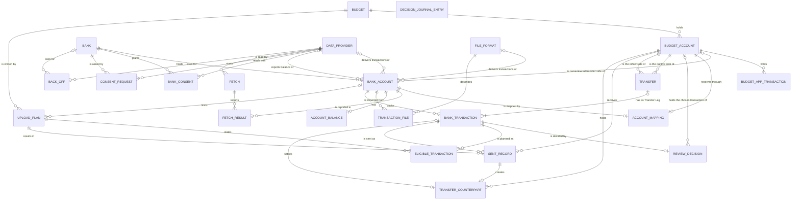

# Entity Model

## Entity Relationship Diagram

### BUDGET

One single-currency workspace in the Budget App that holds Budget Accounts and is shown as its own workspace in Slussen.

| Attribute            | Description                                                              | Data Type | Length/Precision | Validation Rules      |
|----------------------|--------------------------------------------------------------------------|-----------|------------------|-----------------------|
| id                   | Unique identifier                                                        | Long      | 19               | Primary Key, Sequence |
| budget_app_reference | Identifier the Budget App gives this Budget                              | String    | 100              | Not Null, Unique      |
| name                 | Name of the Budget as shown to the operator                              | String    | 100              | Not Null              |
| currency             | ISO 4217 code of the Budget's currency, for example EUR                  | String    | 3                | Not Null              |
| last_read_at         | Time of the last successful read of this Budget from the Budget App, empty before the first one | DateTime  | -                | Optional              |

### BUDGET_ACCOUNT

A place inside a Budget in the Budget App that holds transactions and a balance, and receives the transactions of at most one Bank Account or is a Manually Kept Account.

| Attribute            | Description                                                                         | Data Type | Length/Precision | Validation Rules                  |
|----------------------|-------------------------------------------------------------------------------------|-----------|------------------|-----------------------------------|
| id                   | Unique identifier                                                                   | Long      | 19               | Primary Key, Sequence             |
| budget_id            | Budget the Budget Account belongs to                                                | Long      | 19               | Not Null, Foreign Key (BUDGET.id) |
| budget_app_reference | Identifier the Budget App gives this Budget Account                                 | String    | 100              | Not Null, Unique                  |
| name                 | Name of the Budget Account in the Budget App                                        | String    | 100              | Not Null                          |
| manually_kept        | True when no Source exposes the Budget Account and the operator keeps it by hand     | Boolean   | 1                | Not Null                          |
| balance              | Balance of the Budget Account as the Budget App last reported it, in the Budget's currency | Decimal   | 10,2             | Optional                          |
| balance_read_at      | Time the Budget App last reported the balance                                       | DateTime  | -                | Optional                          |

#### Constraints

- A Manually Kept Account (manually_kept is true) has no Account Mapping.
- balance_read_at is filled exactly when balance is filled.

### BUDGET_APP_TRANSACTION

Slussen's stored copy of one transaction in a Budget Account as it last read it from the Budget App, kept so that the Comparison can recognise deleted and merged transactions and so that the copy can be shown or exported when the Budget App cannot be reached.

| Attribute            | Description                                                                                       | Data Type | Length/Precision | Validation Rules                          |
|----------------------|---------------------------------------------------------------------------------------------------|-----------|------------------|-------------------------------------------|
| id                   | Unique identifier                                                                                 | Long      | 19               | Primary Key, Sequence                     |
| budget_account_id    | Budget Account that holds the transaction                                                         | Long      | 19               | Not Null, Foreign Key (BUDGET_ACCOUNT.id) |
| budget_app_reference | Identifier the Budget App gives the transaction                                                   | String    | 100              | Not Null, Unique                          |
| transaction_date     | Date of the transaction in the Budget App                                                         | Date      | -                | Not Null                                  |
| amount               | Signed amount, negative for an outflow, in the Budget's currency                                  | Decimal   | 10,2             | Not Null                                  |
| payee                | Payee as shown in the Budget App                                                                  | String    | 200              | Optional                                  |
| import_identifier    | Import Identifier the transaction carries, empty for a Typed Entry                                 | String    | 36               | Optional                                  |
| entered_by           | How the transaction came into the Budget App                                                      | String    | 30               | Not Null, Values: Typed Entry, Slussen Or Predecessor App, Other Import Path, Transfer Counterpart |
| state                | Whether the transaction is still present, or was deleted or merged into a Typed Entry since       | String    | 20               | Not Null, Values: Present, Deleted, Merged |

#### Constraints

- entered_by is Slussen Or Predecessor App exactly when import_identifier has the format of C-014.
- A transaction that the Budget App reports as deleted or merged is kept with state Deleted or Merged, never removed, so that the Comparison can recognise it.
- The copy is replaced by what the Budget App reports at every successful read of the Budget; it is never written back to the Budget App.

### DATA_PROVIDER

An external online service from which Slussen fetches transactions and balances of the operator's Bank Accounts.

| Attribute             | Description                                                                                          | Data Type | Length/Precision | Validation Rules      |
|-----------------------|------------------------------------------------------------------------------------------------------|-----------|------------------|-----------------------|
| id                    | Unique identifier                                                                                    | Long      | 19               | Primary Key, Sequence |
| name                  | Name of the Data Provider                                                                            | String    | 50               | Not Null, Unique      |
| source_key            | Source Key that enters every Import Identifier of the Data Provider's transactions                   | String    | 50               | Not Null, Unique      |
| stable_reference      | True when the Data Provider gives every Bank Transaction a Stable Reference                          | Boolean   | 1                | Not Null              |
| bank_consent_required | True when each Bank must grant a Bank Consent before the Data Provider can read it                   | Boolean   | 1                | Not Null              |
| daily_request_limit   | Number of requests Slussen sends to the Data Provider per day at most, set in the Build Configuration, 24 by default | Integer   | 10               | Not Null              |
| request_day           | Day the request count belongs to                                                                     | Date      | -                | Not Null              |
| requests_on_day       | Number of requests Slussen has sent to the Data Provider on request_day                              | Integer   | 10               | Not Null              |

#### Constraints

- requests_on_day never exceeds daily_request_limit.
- When a new day begins, request_day moves to it and requests_on_day starts again at 0.

### FILE_FORMAT

A supported layout of a Transaction File that Slussen can import.

| Attribute          | Description                                                                                        | Data Type | Length/Precision | Validation Rules      |
|--------------------|----------------------------------------------------------------------------------------------------|-----------|------------------|-----------------------|
| id                 | Unique identifier                                                                                  | Long      | 19               | Primary Key, Sequence |
| name               | Name of the File Format                                                                            | String    | 50               | Not Null, Unique      |
| source_key         | Source Key that enters every Import Identifier of the File Format's transactions                   | String    | 50               | Not Null, Unique      |
| reference_kind     | How a transaction in a file of this format gets its Stable Reference                               | String    | 20               | Not Null, Values: Carried, Derived, None |
| upload_window_days | Number of days back from today inside which a transaction from a file of this format may be uploaded | Integer   | 10               | Not Null, Min: 1, Max: 366 |

#### Constraints

- With reference_kind Derived, transactions of one Bank Account that would get the same derived reference have no Stable Reference.

### BANK

A financial service company that holds one or more of the operator's Bank Accounts.

| Attribute | Description                                         | Data Type | Length/Precision | Validation Rules      |
|-----------|-----------------------------------------------------|-----------|------------------|-----------------------|
| id        | Unique identifier                                   | Long      | 19               | Primary Key, Sequence |
| name      | Name of the Bank as shown to the operator           | String    | 100              | Not Null, Unique      |
| country   | ISO 3166 two-letter code of the Bank's country      | String    | 2                | Optional              |

### BANK_ACCOUNT

One of the operator's or a household member's Bank Accounts at a Bank, as exposed by a Data Provider or a File Format and configured in the Build Configuration.

| Attribute                         | Description                                                                                                   | Data Type | Length/Precision | Validation Rules                         |
|-----------------------------------|---------------------------------------------------------------------------------------------------------------|-----------|------------------|------------------------------------------|
| id                                | Unique identifier                                                                                             | Long      | 19               | Primary Key, Sequence                    |
| bank_id                           | Bank that holds the Bank Account                                                                              | Long      | 19               | Not Null, Foreign Key (BANK.id)          |
| bank_account_identity             | Bank Account Identity set in the Build Configuration; for a Bank Account the Predecessor App had, the identity the Predecessor App gave it | String    | 100              | Not Null, Unique                         |
| data_provider_id                  | Data Provider that delivers the Bank Account's transactions, empty when they come from Transaction Files     | Long      | 19               | Optional                                 |
| file_format_id                    | File Format of the Bank Account's Transaction Files, empty when a Data Provider delivers the transactions     | Long      | 19               | Optional                                 |
| balance_data_provider_id          | Data Provider that reports the Bank Account's balance when the transactions come from Transaction Files      | Long      | 19               | Optional                                 |
| name                              | Name of the Bank Account as shown to the operator                                                             | String    | 100              | Not Null                                 |
| currency                          | ISO 4217 code of the Bank Account's currency                                                                  | String    | 3                | Not Null                                 |
| bank_account_type                 | Kind of Bank Account, which decides which Transfers it can take part in                                       | String    | 20               | Not Null, Values: Checking, Savings, Credit Card, Other |
| provider_reference                | Identifier the Data Provider gives the Bank Account, recorded once the Bank Account is identified with certainty | String    | 200              | Optional                                 |
| bank_account_fingerprint          | One-way fingerprint of the Bank Account number that recognises the Bank Account when the Data Provider's identifier changes | String    | 64               | Optional                                 |
| balance_provider_reference        | Identifier the balance Data Provider gives the Bank Account                                                   | String    | 200              | Optional                                 |
| retired                           | True when the operator has retired the Bank Account so that it is neither fetched nor uploaded                | Boolean   | 1                | Not Null                                 |
| transfer_budget_account_id        | Budget Account the operator chose to remember as the other side of this Bank Account's Transfers               | Long      | 19               | Optional                                 |

#### Constraints

- Exactly one of data_provider_id and file_format_id is filled.
- balance_data_provider_id is filled only when file_format_id is filled.
- balance_provider_reference is filled exactly when balance_data_provider_id is filled.
- Two Bank Accounts of the same Data Provider never have the same provider_reference or the same bank_account_fingerprint.
- bank_account_identity never changes, also not when the Bank Account is retired, restored or identified again.
- transfer_budget_account_id belongs to the same Budget as the Bank Account's own Account Mapping.
- A Retired Account keeps its identity, Account Mapping and history and can be restored.

### ACCOUNT_MAPPING

The configured link from one Bank Account to one Budget Account, locked once a transaction has been sent through it.

| Attribute         | Description                                                                                  | Data Type | Length/Precision | Validation Rules                          |
|-------------------|----------------------------------------------------------------------------------------------|-----------|------------------|-------------------------------------------|
| id                | Unique identifier                                                                            | Long      | 19               | Primary Key, Sequence                     |
| bank_account_id   | Bank Account whose transactions the mapping sends                                            | Long      | 19               | Not Null, Foreign Key (BANK_ACCOUNT.id)   |
| budget_account_id | Budget Account that receives the Bank Account's transactions                                 | Long      | 19               | Not Null, Foreign Key (BUDGET_ACCOUNT.id) |
| locked_at         | Time the first transaction was recorded as sent through the mapping, whatever the outcome; empty until then | DateTime  | -                | Optional                                  |

#### Constraints

- A Bank Account has at most one Account Mapping, and a Budget Account receives through at most one Account Mapping.
- The Bank Account's currency equals the currency of the Budget Account's Budget; otherwise the Bank Account is blocked from upload.
- Once locked_at is filled, budget_account_id never changes.

### BANK_CONSENT

The Bank's permission, granted by the operator through Strong Customer Authentication, that lets a Data Provider read the operator's Bank Accounts at that Bank until it expires.

| Attribute        | Description                                       | Data Type | Length/Precision | Validation Rules                         |
|------------------|---------------------------------------------------|-----------|------------------|------------------------------------------|
| id               | Unique identifier                                 | Long      | 19               | Primary Key, Sequence                    |
| bank_id          | Bank that granted the consent                     | Long      | 19               | Not Null, Foreign Key (BANK.id)          |
| data_provider_id | Data Provider that reads with the consent         | Long      | 19               | Not Null, Foreign Key (DATA_PROVIDER.id) |
| granted_at       | Time the operator granted or renewed the consent  | DateTime  | -                | Not Null                                 |
| expires_at       | Time the consent expires                          | DateTime  | -                | Not Null                                 |

#### Constraints

- expires_at is after granted_at.
- A Bank has at most one Bank Consent per Data Provider; renewing replaces it.
- A Bank Consent is not restored after a reinstall of Slussen.

### CONSENT_REQUEST

One attempt to grant or renew the Bank Consent of a Bank, started with a Data Provider and answered at most once.

| Attribute        | Description                                                    | Data Type | Length/Precision | Validation Rules                         |
|------------------|----------------------------------------------------------------|-----------|------------------|------------------------------------------|
| id               | Unique identifier                                              | Long      | 19               | Primary Key, Sequence                    |
| bank_id          | Bank whose Bank Consent is requested                           | Long      | 19               | Not Null, Foreign Key (BANK.id)          |
| data_provider_id | Data Provider with which the request was started               | Long      | 19               | Not Null, Foreign Key (DATA_PROVIDER.id) |
| started_at       | Time Slussen started the request                               | DateTime  | -                | Not Null                                 |
| expires_at       | Time after which an answer to the request is rejected          | DateTime  | -                | Not Null                                 |
| answered         | True once an answer to the request has been accepted           | Boolean   | 1                | Not Null                                 |

#### Constraints

- expires_at is 15 minutes after started_at.
- Only the most recent Consent Request of a Bank and Data Provider can be answered; starting a new one makes the earlier ones unanswerable.
- A Consent Request is never included in device backups and is not restored after a reinstall.

### FETCH

One operator-started read of transactions and balances from a Data Provider.

| Attribute        | Description                                   | Data Type | Length/Precision | Validation Rules                         |
|------------------|-----------------------------------------------|-----------|------------------|------------------------------------------|
| id               | Unique identifier                             | Long      | 19               | Primary Key, Sequence                    |
| data_provider_id | Data Provider that was read                   | Long      | 19               | Not Null, Foreign Key (DATA_PROVIDER.id) |
| started_at       | Time the operator started the Fetch           | DateTime  | -                | Not Null                                 |
| outcome          | What the Fetch achieved                       | String    | 30               | Not Null, Values: Fetched, Served From Fetch Cooldown, Waiting For Back-off, Daily Limit Reached, Failed, Not Consented, Configuration Error |

#### Constraints

- Only the 60 most recent Fetches are kept.

### FETCH_RESULT

The outcome of one Fetch for one Bank Account, from which the Bank Account's Source Health and Freshness are shown.

| Attribute         | Description                                       | Data Type | Length/Precision | Validation Rules                         |
|-------------------|---------------------------------------------------|-----------|------------------|------------------------------------------|
| fetch_id          | Fetch that produced the result                    | Long      | 19               | Primary Key, Foreign Key (FETCH.id)      |
| bank_account_id   | Bank Account the result is for                    | Long      | 19               | Primary Key, Foreign Key (BANK_ACCOUNT.id) |
| outcome           | Outcome for the Bank Account                      | String    | 30               | Not Null, Values: Fetched, Failed, Not Consented, Not Recognised, Ambiguous Bank Account |
| transaction_count | Number of booked Bank Transactions delivered      | Integer   | 10               | Not Null                                 |

#### Constraints

- The primary key is the combination of fetch_id and bank_account_id.

### BACK_OFF

A period during which Slussen does not contact a Data Provider, or one Bank through it, because the provider asked it to wait or a transient failure occurred.

| Attribute        | Description                                               | Data Type | Length/Precision | Validation Rules                         |
|------------------|-----------------------------------------------------------|-----------|------------------|------------------------------------------|
| id               | Unique identifier                                         | Long      | 19               | Primary Key, Sequence                    |
| data_provider_id | Data Provider that must not be contacted                  | Long      | 19               | Not Null, Foreign Key (DATA_PROVIDER.id) |
| bank_id          | Bank that must not be contacted, empty when the whole Data Provider waits | Long      | 19               | Optional                                 |
| cause            | Why Slussen waits                                         | String    | 30               | Not Null, Values: Request To Wait, Transient Failure |
| starts_at        | Time the Back-off began                                   | DateTime  | -                | Not Null                                 |
| ends_at          | Time after which Slussen may contact the provider again   | DateTime  | -                | Not Null                                 |

#### Constraints

- ends_at is after starts_at.
- With cause Request To Wait, ends_at is the end of the period the provider named, or 8 hours after starts_at when it named none; with cause Transient Failure, ends_at is 30 minutes after starts_at.
- A Back-off with cause Request To Wait holds even when the operator starts a Fetch; one with cause Transient Failure holds until ends_at unless the operator explicitly chooses to retry the Data Provider now.

### ACCOUNT_BALANCE

The most recent balance of a Bank Account as reported by its Data Provider.

| Attribute       | Description                                      | Data Type | Length/Precision | Validation Rules                        |
|-----------------|--------------------------------------------------|-----------|------------------|-----------------------------------------|
| id              | Unique identifier                                | Long      | 19               | Primary Key, Sequence                   |
| bank_account_id | Bank Account the balance belongs to              | Long      | 19               | Not Null, Foreign Key (BANK_ACCOUNT.id) |
| amount          | Balance in the Bank Account's currency           | Decimal   | 10,2             | Not Null                                |
| currency        | ISO 4217 code of the reported currency           | String    | 3                | Not Null                                |
| reported_at     | Time the Data Provider reported the balance      | DateTime  | -                | Not Null                                |

#### Constraints

- When reported_at is older than the configured limit (36 hours by default), the balance difference to the Budget Account is hidden and marked as outdated.

### TRANSACTION_FILE

A file of transactions that the operator downloaded from a Bank and imported for one Bank Account.

| Attribute         | Description                                                    | Data Type | Length/Precision | Validation Rules                         |
|-------------------|----------------------------------------------------------------|-----------|------------------|------------------------------------------|
| id                | Unique identifier                                              | Long      | 19               | Primary Key, Sequence                    |
| bank_account_id   | Bank Account the file belongs to                               | Long      | 19               | Not Null, Foreign Key (BANK_ACCOUNT.id)  |
| file_format_id    | File Format the file was read with                             | Long      | 19               | Not Null, Foreign Key (FILE_FORMAT.id)   |
| imported_at       | Time the operator imported the file                            | DateTime  | -                | Not Null                                 |
| outcome           | Whether the file was taken in as a whole or rejected as a whole | String    | 20               | Not Null, Values: Imported, Rejected     |
| transaction_count | Number of Bank Transactions the file delivered                 | Integer   | 10               | Not Null                                 |
| rejection_reason  | Reason shown to the operator when the file was rejected        | String    | 200              | Optional                                 |

#### Constraints

- file_format_id equals the File Format of the Bank Account.
- rejection_reason is filled exactly when outcome is Rejected, and then transaction_count is 0.

### BANK_TRANSACTION

One booked, non-zero transaction of a Bank Account as delivered by a Data Provider or a Transaction File, together with the Transaction Status its latest Comparison gave it.

| Attribute         | Description                                                                                         | Data Type | Length/Precision | Validation Rules                        |
|-------------------|-----------------------------------------------------------------------------------------------------|-----------|------------------|-----------------------------------------|
| id                | Unique identifier                                                                                   | Long      | 19               | Primary Key, Sequence                   |
| bank_account_id   | Bank Account that booked the transaction                                                            | Long      | 19               | Not Null, Foreign Key (BANK_ACCOUNT.id) |
| stable_reference  | Stable Reference of the transaction, empty when it has none                                         | String    | 200              | Optional                                |
| occurrence_number | Position of the transaction among the transactions of its Bank Account that are identical in date, amount, payee and memo and have no Stable Reference; 1 for the first | Integer   | 10               | Not Null                                |
| import_identifier | Import Identifier derived from the Source Key, the Bank Account Identity and the Stable Reference, or, without a Stable Reference, from the date, amount, payee, memo and occurrence_number | String    | 36               | Not Null, Unique                        |
| booked_date       | Date the Bank booked the transaction                                                                | Date      | -                | Not Null                                |
| amount            | Signed amount, negative for an outflow, in the Bank Account's currency                              | Decimal   | 10,2             | Not Null                                |
| currency          | ISO 4217 code of the amount's currency                                                              | String    | 3                | Not Null                                |
| payee             | Payee as delivered by the Source, in full                                                           | String    | 500              | Optional                                |
| memo              | Memo as delivered by the Source, in full                                                            | String    | 500              | Optional                                |
| first_seen_at     | Time Slussen first received the transaction                                                         | DateTime  | -                | Not Null                                |
| status            | Transaction Status from the latest Comparison                                                       | String    | 40               | Not Null, Values: New, Match For Typed Entry, Already In Budget App, Possible Import By Other Path, Deferred, Deleted In Budget App, Merged In Budget App, Decision No Longer Holds, Needs Review, Too Old, In The Future, Outcome Unknown, Transfer Leg, Guessed Transfer, Held Transfer, Arrived As Transfer Counterpart, Transfer Counterpart Changed |
| transfer_id       | Transfer the transaction is a Transfer Leg of, empty for an ordinary transaction                    | Long      | 19               | Optional                                |

#### Constraints

- amount is never 0.
- Within one Bank Account, two Bank Transactions never have the same stable_reference.
- occurrence_number is 1 for every transaction that has a stable_reference.
- A transaction without a stable_reference, or one its Source cannot interpret, has status Needs Review until the operator decides; it is never merged with another transaction.
- A transaction dated outside the Upload Window that has not been sent has status Too Old or In The Future and stays visible, also when it leaves the window while waiting for a Review Decision.
- Only a transaction with status New, Match For Typed Entry, Transfer Leg or Outcome Unknown can become an Eligible Transaction.

### REVIEW_DECISION

The operator's current choice for one doubtful Bank Transaction, which can be changed until the transaction is uploaded.

| Attribute                   | Description                                                                                 | Data Type | Length/Precision | Validation Rules                          |
|-----------------------------|---------------------------------------------------------------------------------------------|-----------|------------------|-------------------------------------------|
| id                          | Unique identifier                                                                           | Long      | 19               | Primary Key, Sequence                     |
| bank_transaction_id         | Bank Transaction the decision is about                                                      | Long      | 19               | Not Null, Foreign Key (BANK_TRANSACTION.id) |
| choice                      | What the operator decided                                                                   | String    | 20               | Not Null, Values: Already Present, Import Anyway, Defer, Re-upload |
| chosen_budget_app_reference | Identifier in the Budget App of the transaction the operator chose as already present       | String    | 100              | Optional                                  |
| chosen_budget_account_id    | Budget Account that held the chosen transaction when the operator decided                   | Long      | 19               | Optional                                  |
| chosen_amount               | Amount of the chosen transaction when the operator decided                                  | Decimal   | 10,2             | Optional                                  |
| decided_at                  | Time the operator made or last changed the decision                                         | DateTime  | -                | Not Null                                  |

#### Constraints

- A Bank Transaction has at most one Review Decision.
- chosen_budget_app_reference, chosen_budget_account_id and chosen_amount are filled exactly when choice is Already Present.
- An Already Present decision no longer holds when the chosen transaction is deleted in the Budget App, is in another Budget Account than chosen_budget_account_id, or has an amount other than chosen_amount.
- The decision cannot be changed once the Bank Transaction has a Sent Record with outcome Written.

### TRANSFER

A movement of money between two of the operator's Bank Accounts in the same Budget and currency, detected from one or two Transfer Legs, together with the operator's Transfer Decision on it.

| Attribute                  | Description                                                                         | Data Type | Length/Precision | Validation Rules                          |
|----------------------------|-------------------------------------------------------------------------------------|-----------|------------------|-------------------------------------------|
| id                         | Unique identifier                                                                   | Long      | 19               | Primary Key, Sequence                     |
| outflow_budget_account_id  | Budget Account of the outflow side                                                  | Long      | 19               | Not Null, Foreign Key (BUDGET_ACCOUNT.id) |
| inflow_budget_account_id   | Budget Account of the inflow side                                                   | Long      | 19               | Not Null, Foreign Key (BUDGET_ACCOUNT.id) |
| amount                     | Amount moved, in the Budget's currency                                              | Decimal   | 10,2             | Not Null                                  |
| transfer_type              | Whether the Transfer is a card payment or a move between Bank Accounts              | String    | 20               | Not Null, Values: Card Payment, Bank Transfer |
| guessed                    | True for a Guessed Transfer that needs the operator's confirmation                  | Boolean   | 1                | Not Null                                  |
| decision                   | The operator's Transfer Decision                                                    | String    | 30               | Not Null, Values: Proposed, Confirmed, Split, Held, Budget Account Chosen |
| decided_at                 | Time the operator made or last changed the decision, empty while Proposed           | DateTime  | -                | Optional                                  |

#### Constraints

- outflow_budget_account_id and inflow_budget_account_id differ and belong to the same Budget.
- A Transfer has one or two Transfer Legs; with one it is a Lonely Transfer.
- The two Transfer Legs have equal and opposite amounts, lie in the Bank Accounts mapped to the outflow and inflow Budget Accounts, and are dated at most the configured number of days apart (5 by default).
- A Lonely Transfer whose other Transfer Leg has not arrived within the configured grace period (6 days by default) becomes an ordinary transaction.
- A Confirmed or Budget Account Chosen decision clears guessed.
- A Transfer that is guessed is never uploaded while its decision is Proposed.
- The decision cannot be changed once a Transfer Leg has a Sent Record with outcome Written.

### UPLOAD_PLAN

The reviewed statement of exactly what Slussen will write to one Budget, or to one Bank Account's Budget Account, which the operator confirms or cancels.

| Attribute             | Description                                                                         | Data Type | Length/Precision | Validation Rules                  |
|-----------------------|-------------------------------------------------------------------------------------|-----------|------------------|-----------------------------------|
| id                    | Unique identifier                                                                   | Long      | 19               | Primary Key, Sequence             |
| budget_id             | Budget the plan writes to                                                           | Long      | 19               | Not Null, Foreign Key (BUDGET.id) |
| bank_account_id       | Bank Account the plan is limited to, empty for a plan for the whole Budget          | Long      | 19               | Optional                          |
| prepared_at           | Time the plan was prepared                                                          | DateTime  | -                | Not Null                          |
| expires_at            | Time after which confirming the plan writes nothing                                 | DateTime  | -                | Not Null                          |
| new_count             | Number of transactions the plan creates                                             | Integer   | 10               | Not Null                          |
| match_count           | Number of transactions the plan sends as a match for a Typed Entry                  | Integer   | 10               | Not Null                          |
| counterpart_count     | Number of Transfer Counterparts the plan marks cleared                              | Integer   | 10               | Not Null                          |
| total_inflow          | Sum of the inflows the plan writes, in the Budget's currency                        | Decimal   | 10,2             | Not Null                          |
| total_outflow         | Sum of the outflows the plan writes, in the Budget's currency                       | Decimal   | 10,2             | Not Null                          |
| state                 | Where the plan stands                                                               | String    | 30               | Not Null, Values: Awaiting Confirmation, Confirmed, Cancelled, Expired, Changed Before Writing |

#### Constraints

- expires_at is 10 minutes after prepared_at.
- At most one Upload Plan is Awaiting Confirmation at a time.
- A plan Awaiting Confirmation whose expires_at has passed becomes Expired.
- new_count, match_count, total_inflow and total_outflow equal what the plan's Eligible Transactions add up to.
- A plan is Changed Before Writing, and writes nothing, when the Budget App, the Bank Transactions or the configuration changed after it was prepared.

### ELIGIBLE_TRANSACTION

A Bank Transaction that an Upload Plan will write when the operator confirms the plan.

| Attribute           | Description                                                                          | Data Type | Length/Precision | Validation Rules                               |
|---------------------|--------------------------------------------------------------------------------------|-----------|------------------|------------------------------------------------|
| upload_plan_id      | Upload Plan that states the transaction                                              | Long      | 19               | Primary Key, Foreign Key (UPLOAD_PLAN.id)      |
| bank_transaction_id | Bank Transaction to be written                                                       | Long      | 19               | Primary Key, Foreign Key (BANK_TRANSACTION.id) |
| upload_kind         | How the transaction is written                                                       | String    | 30               | Not Null, Values: New, Match For Typed Entry, Linked Transfer |
| clear_counterpart   | True when the Transfer Counterpart this transaction creates is marked cleared at once | Boolean   | 1                | Not Null                                       |

#### Constraints

- The primary key is the combination of upload_plan_id and bank_transaction_id.
- clear_counterpart is true only when upload_kind is Linked Transfer and both Transfer Legs are present.
- A Transfer is written through exactly one of its Transfer Legs: the outflow leg when both Transfer Legs are present.

### SENT_RECORD

Slussen's own durable record of one transaction it sent to the Budget App, which survives a reinstall and is the basis of exactly-once.

| Attribute            | Description                                                                                     | Data Type | Length/Precision | Validation Rules                            |
|----------------------|-------------------------------------------------------------------------------------------------|-----------|------------------|---------------------------------------------|
| id                   | Unique identifier                                                                               | Long      | 19               | Primary Key, Sequence                       |
| bank_transaction_id  | Bank Transaction that was sent                                                                  | Long      | 19               | Not Null, Foreign Key (BANK_TRANSACTION.id) |
| upload_plan_id       | Confirmed Upload Plan the send belonged to                                                      | Long      | 19               | Not Null, Foreign Key (UPLOAD_PLAN.id)      |
| budget_account_id    | Budget Account the transaction was sent to                                                      | Long      | 19               | Not Null, Foreign Key (BUDGET_ACCOUNT.id)   |
| import_identifier    | Import Identifier sent with the transaction, which the Budget App uses to refuse a second copy   | String    | 36               | Not Null, Unique                            |
| occurrence           | 0 for the first send, raised by one for each deliberate Re-upload                               | Integer   | 10               | Not Null                                    |
| booked_date          | Date sent with the transaction                                                                  | Date      | -                | Not Null                                    |
| amount               | Amount sent with the transaction                                                                | Decimal   | 10,2             | Not Null                                    |
| sent_as_transfer     | True when the transaction was sent as a linked Transfer                                         | Boolean   | 1                | Not Null                                    |
| sent_at              | Time Slussen recorded the transaction as sent, before sending it                                | DateTime  | -                | Not Null                                    |
| outcome              | What the Budget App confirmed                                                                   | String    | 20               | Not Null, Values: Not Yet Known, Written, Already Present, Rejected, Unknown |
| budget_app_reference | Identifier the Budget App gave the created transaction, empty until it is confirmed             | String    | 100              | Optional                                    |

#### Constraints

- The import_identifier of the first send (occurrence 0) equals the Bank Transaction's import_identifier; each Re-upload uses a new import_identifier derived from it and the occurrence (C-014).
- A Bank Transaction with a Sent Record whose outcome is Written or Already Present is not sent again, except by a Re-upload Review Decision.
- A Sent Record with outcome Not Yet Known or Unknown keeps its import_identifier and budget_account_id, so that sending it again goes to the same Budget Account and creates nothing that already arrived.
- An outcome Not Yet Known or Unknown becomes Written when a later read of the Budget App finds the import_identifier in budget_account_id.
- budget_app_reference is filled only when outcome is Written or Already Present.

### TRANSFER_COUNTERPART

The other side of a Transfer that the Budget App created itself when Slussen sent one Transfer Leg as a linked transfer.

| Attribute                | Description                                                                         | Data Type | Length/Precision | Validation Rules                          |
|--------------------------|-------------------------------------------------------------------------------------|-----------|------------------|-------------------------------------------|
| id                       | Unique identifier                                                                   | Long      | 19               | Primary Key, Sequence                     |
| sent_record_id           | Sent Record of the Transfer Leg whose sending created the counterpart               | Long      | 19               | Not Null, Foreign Key (SENT_RECORD.id)    |
| budget_account_id        | Budget Account that holds the counterpart                                           | Long      | 19               | Not Null, Foreign Key (BUDGET_ACCOUNT.id) |
| budget_app_reference     | Identifier the Budget App gave the counterpart                                      | String    | 100              | Not Null, Unique                          |
| state                    | Where the counterpart stands                                                        | String    | 30               | Not Null, Values: Uncleared, Cleared, Changed In Budget App |
| cleared_at               | Time Slussen marked the counterpart cleared                                         | DateTime  | -                | Optional                                  |
| settled_by_transaction_id | Bank Transaction of the other side whose arrival settled the counterpart          | Long      | 19               | Optional                                  |

#### Constraints

- A Sent Record creates at most one Transfer Counterpart, and only when sent_as_transfer is true.
- Marking a Transfer Counterpart cleared is the only change Slussen makes to an existing transaction in the Budget App.
- cleared_at is filled exactly when state is Cleared.
- When the counterpart is Changed In Budget App, the arriving Bank Transaction of that side gets status Transfer Counterpart Changed and is shown for review instead of being held back.

### DECISION_JOURNAL_ENTRY

One event in the Decision Journal: what Slussen fetched or concluded, what the operator decided or changed, or what later happened to an Import that Slussen sent.

| Attribute         | Description                                                                                 | Data Type | Length/Precision | Validation Rules      |
|-------------------|---------------------------------------------------------------------------------------------|-----------|------------------|-----------------------|
| id                | Unique identifier                                                                           | Long      | 19               | Primary Key, Sequence |
| recorded_at       | Time the event happened                                                                     | DateTime  | -                | Not Null              |
| event_type        | Kind of event                                                                               | String    | 40               | Not Null, Values: Session Start, Configuration Change, Transaction Seen, Transaction Changed, Status Changed, Operator Decision, Upload Plan, Upload, Budget App Outcome, Account Mapping Change, Journal Control |
| import_identifier | Import Identifier of the Bank Transaction the event concerns, empty for other events        | String    | 36               | Optional              |
| details           | What the event recorded, for example the status Slussen had proposed and the operator's choice | String    | 4000             | Not Null              |

#### Constraints

- An entry refers to a Bank Transaction only through import_identifier, never as a dependency, so that clearing or losing the Decision Journal changes nothing else.
- details never holds credentials, Bank Consent data, Bank Account numbers or identifiers Data Providers give Bank Accounts.
- The Decision Journal stays within the size limit the operator sets (10 to 500 MB, 50 MB by default) by dropping its oldest entries.
